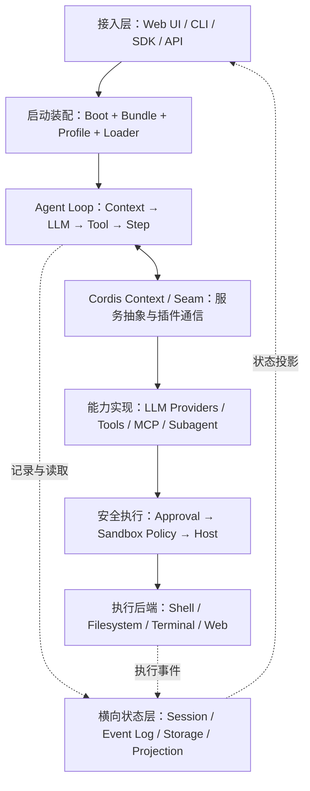
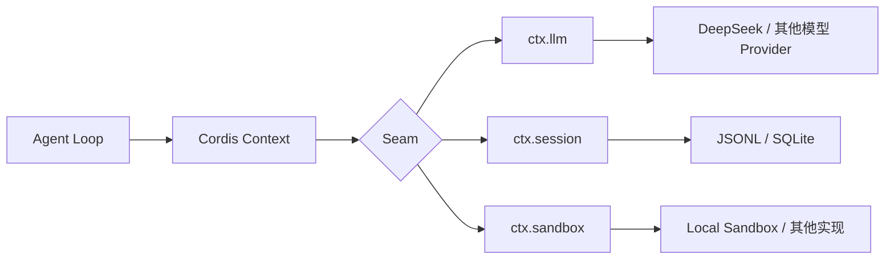
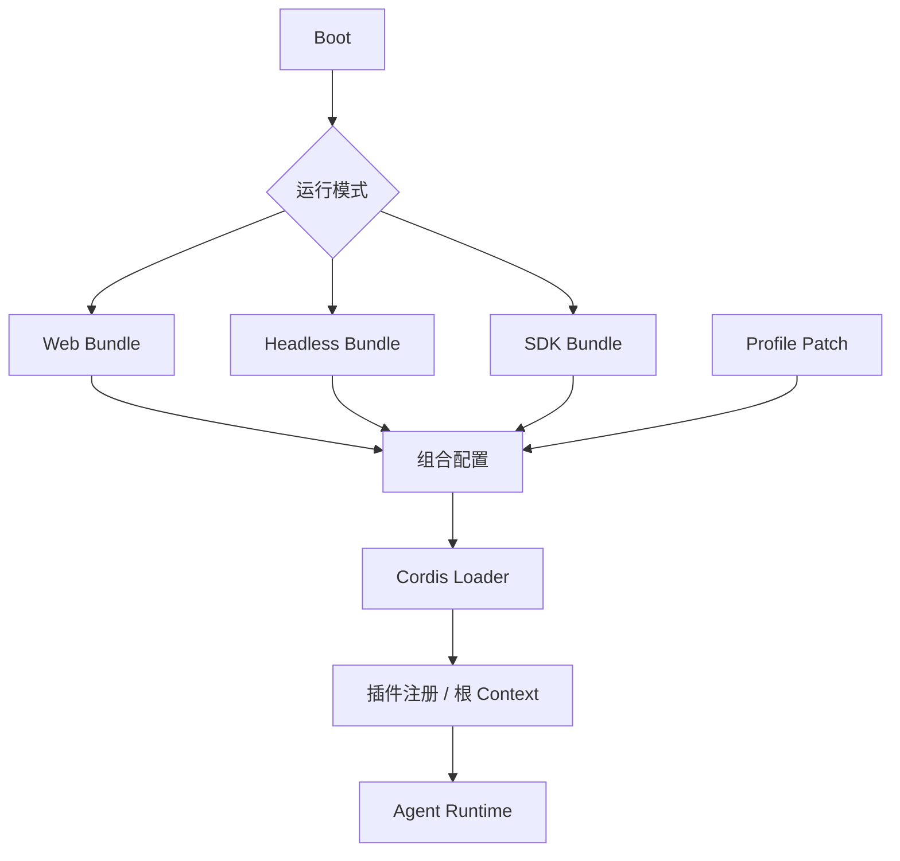
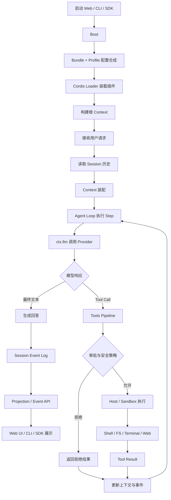
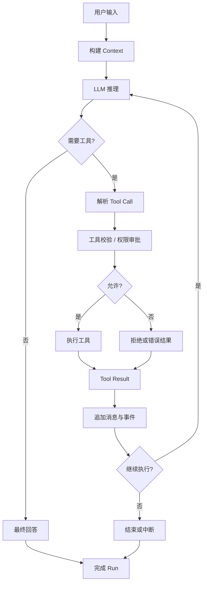
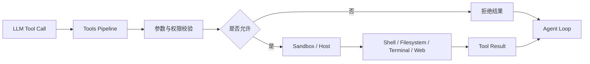
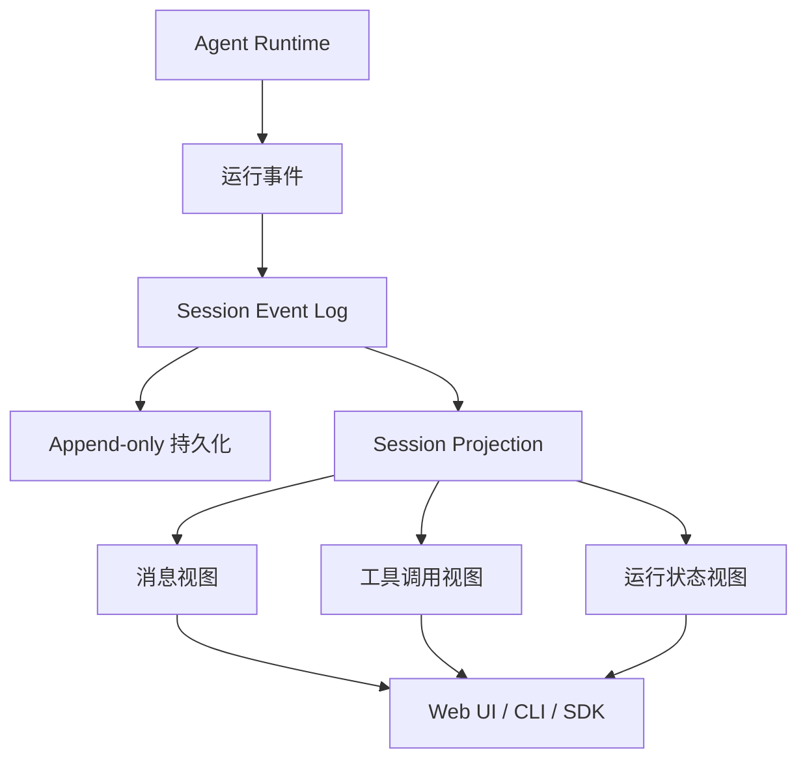

# DeepSeek Harness 架构设计与完整调用流程

> 基于 DeepSeek Harness 架构总览（页面标注版本 DSH v0.1.5-alpha.1）整理。本文中的七层模型是便于理解和设计的**逻辑重构**，并非源码目录的一一映射。

## 1. 架构概述

DSH 是基于插件组合机制的 AI Agent 运行框架：以 Cordis Context 负责服务组合与依赖访问，以 Agent Loop 驱动执行，以 Seam 抽象能力边界，通过 Bundle 与 Profile 选择具体应用能力。

### 1.1 七层逻辑架构

| 层级 | 组成 | 职责 |
| --- | --- | --- |
| 接入交互层 | Web UI、CLI、SDK、API | 接收请求、展示消息和运行状态 |
| 启动装配层 | Boot、Bundle、Profile、Loader | 合并配置、装载插件、构建 Context |
| Agent 编排层 | Agent Loop、Context 装配、Step | 模型请求、工具调度、循环控制 |
| 能力抽象层 | Cordis Context、Seam | 服务注册、依赖注入、事件通信 |
| 能力实现层 | LLM Provider、Tool Plugin、MCP 等 | 提供模型与工具能力 |
| 安全执行层 | Approval、Sandbox Policy、Host | 审批、策略检查、执行隔离 |
| 状态持久化层 | Session、Event Log、Storage、Projection | 记录历史、生成会话视图 |

### 1.2 系统架构图



> Session/Event 是横向能力，不表示所有事件只在流程末尾写入。

## 2. 核心模块及边界

### 2.1 Cordis 与 Seam

- **Cordis Context**：管理插件及服务依赖，向消费方提供能力入口。
- **Seam（能力缝）**：将抽象接口与具体实现解耦。消费方使用 `ctx.llm` 等入口，而非直接依赖某个 Provider。
- **实现插件**：在对应抽象接口下提供实际能力，如模型 Provider、Session 持久化或沙箱后端。



### 2.2 Bundle、Profile 与 Plugin

| 概念 | 定义 | 主要问题 |
| --- | --- | --- |
| Plugin | 可装载的功能实现 | 系统有什么能力？ |
| Bundle | 预先组合的插件及配置/patch | 如何复用一组能力？ |
| Profile | Bundle 层与用户覆盖层叠加的最终配置 | 当前实例如何定制？ |

装配关系：



注意：`sdk-minimal` 是独立完整配置树，并非统一继承 `base`。Bundle 的继承与覆盖关系应以实际配置为准。

## 3. 端到端请求调用流程

分为两个阶段：

1. **初始化**：启动应用，加载 Bundle 和 Profile，装载插件，构建根 Context。
2. **请求执行**：接收消息，构造上下文，调用模型，必要时执行工具，记录事件并输出结果。



> 该图表示逻辑关系；真实实现中的流式输出、事件写入和权限检查可能交错进行。

### 3.1 阶段职责

| 阶段 | 输入 | 处理 | 输出 |
| --- | --- | --- | --- |
| 启动 | 启动参数 | 选择运行模式 | 配置上下文 |
| 装配 | Bundle + Profile | 合并 patch、加载插件 | 根 Context |
| 接入 | 消息/API | 关联 Session | Agent 请求 |
| 上下文 | 历史、指令、工具定义 | 装配模型消息 | LLM 输入 |
| 模型调用 | Messages、Model Config | Provider 推理 | 文本或 Tool Call |
| 工具执行 | Tool Call | 审批、策略、宿主执行 | Tool Result |
| 循环控制 | Tool Result | 更新上下文并继续 Step | 下一轮或结束 |
| 持久化 | 运行事件 | Append-only 追加 | 会话日志 |
| 输出 | 事件及最终响应 | 状态投影 | 客户端结果 |

## 4. Agent Loop 内部机制

一次 Run 可以包含多个 Step。模型可能直接回答，也可能请求工具调用；工具结果再进入下一轮模型上下文。



### 4.1 概念解释

- **Run**：从接收请求到完成或中断的完整执行过程。
- **Step**：一次模型交互及相关处理步骤。
- **Tool Call**：模型产生的结构化工具调用意图，不等于模型直接执行操作系统命令。
- **Tool Result**：工具执行结果，通常进入下一轮模型上下文。

### 4.2 示例：分析 package.json

1. 用户请求“读取 package.json 并分析技术栈”。
2. Agent Loop 装配上下文并调用 LLM。
3. 模型返回读取文件的 Tool Call。
4. Tools Pipeline 校验参数及权限，选择文件系统能力读取文件。
5. 结果进入 Session/Context，Agent Loop 再次调用 LLM。
6. 模型生成依赖分析，客户端接收输出，相关事件被记录。

示例 Tool Call（**示意格式，非 DSH 精确协议**）：

```json
{
  "tool": "read_file",
  "arguments": { "path": "package.json" }
}
```

## 5. 工具执行与安全边界

模型只能提出工具调用意图，实际执行由 Tools Pipeline、权限策略和宿主执行后端负责。Approval 与 Sandbox Policy 分别关注用户授权与执行隔离/限制；具体调用顺序取决于工具实现。



## 6. Session 与 Event 架构

Session 不只是消息数组。追加式事件日志（Append-only Event Log）保存执行过程，Projection 将事件转换为客户端可消费的状态。



事件可以按逻辑分为用户消息、模型响应、工具调用、工具结果和运行状态等。**这些是概念分类，并非精确源码事件名称**。

- **Event Log**：发生过什么。
- **Projection**：如何从事件计算当前展示状态。
- **Session**：会话生命周期与历史管理。

## 7. 开发落地建议

1. **最小闭环**：先实现输入 → LLM → Tool Call → Tool Result → 最终回答。
2. **抽象服务**：为 LLM、Tools、Session 建立稳定 Seam。
3. **插件装配**：引入 Plugin 注册、Bundle 预设和 Profile 覆盖。
4. **安全控制**：补充工具审批、参数校验、沙箱策略和宿主隔离。
5. **可观测性**：通过 Session Event Log 追踪执行步骤、错误和工具结果。
6. **多端支持**：通过 Event/API Projection 支持 Web、CLI 和 SDK。

## 8. 总结

**配置决定装配什么能力 → Cordis 提供服务访问 → Agent Loop 驱动模型与工具 → 安全执行层控制外部操作 → Session/Event 记录过程 → 客户端展示结果。**

DSH 的关键优势是通过 Seam 和插件组合解耦能力实现，以 Agent Loop 管理多步骤执行，以事件与状态投影支持不同应用界面。