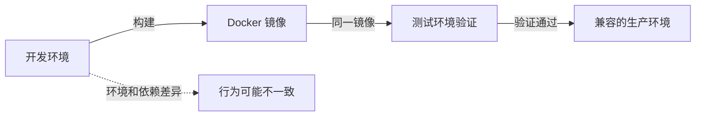
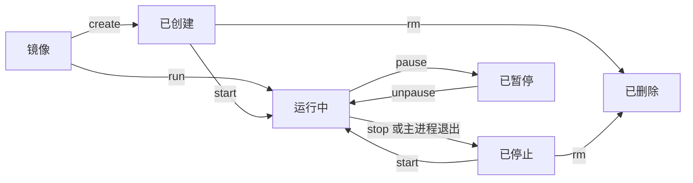

#### 8.1.5 挂载数据卷
`src` 是卷名，`dst` 是容器内路径；卷不存在时 Docker 会创建它。空卷首次挂载到镜像中的非空目录时，Docker 默认可复制该目录内容；不需要复制时可设置 `volume-nocopy`。
`volume rm` 删除指定的未使用卷；`volume prune` 默认清理未使用的匿名卷，`--all` 会把未使用的命名卷也纳入清理范围，详见 [Docker 官方命令说明](https://docs.docker.com/reference/cli/docker/volume/prune/)。
#### 8.2.1 什么是绑定挂载
绑定挂载（Bind Mount）把 **Docker 守护进程所在主机**上的文件或目录映射到容器。远程 Docker 的主机路径是远程服务器上的路径，不一定是运行 Docker 命令的电脑路径。挂载会遮住容器目标路径原有的内容，挂载前先确认目标路径。
# Docker 学习笔记

## 目录

1. [Docker 入门](#1-docker-入门)
   - 什么是 Docker
   - 为什么要用 Docker
   - Docker 是什么、适合解决什么问题
   - 镜像、容器、仓库和数据卷
   - 容器与虚拟机的区别
2. [安装与快速体验](#2-安装与快速体验)
   - Windows：Docker Desktop 与 WSL 2
   - Linux、macOS 安装入口
   - 验证安装并运行第一个容器
3. [镜像管理](#3-镜像管理)
   - 概念
   - 获取镜像
   - 列出镜像
   - 删除本地镜像
   - 使用 commit 理解分层
   - 使用 Dockerfile 构建镜像
   - 其他镜像制作与迁移方式
   - 镜像实现原理
4. [容器管理](#4-容器管理)
   - 概念与生命周期
   - 创建与启动
   - 前台与后台运行
   - 常用启动选项
   - 查看与排查
   - 进入容器
   - 停止、重启与暂停
   - 删除与命令速查
5. [Docker Compose](#5-docker-compose)
   - 概念与安装检查
   - 单服务快速体验
   - 常用命令与配置项
   - 多容器实践与排查
6. [数据持久化](#6-数据持久化)
   - 概念
   - 8.1 数据卷
   - 8.2 挂载主机目录
   - 8.3 tmpfs 挂载
   - 本章小结
7. [网络与外部访问](#7-网络与外部访问)
   - 端口映射与访问地址
   - 主机防火墙和云服务器安全组
   - 数据库远程访问与安全注意事项
8. [构建自己的镜像](#8-构建自己的镜像)
   - `Dockerfile` 的作用与基本指令
   - 构建并运行一个简单镜像
9. [常见应用实践](#9-常见应用实践)
   - MySQL：数据持久化、账号与连接
   - Redis：Docker Compose 安装与使用
   - Nginx：配置文件与网页目录挂载
   - Node.js：运行应用与映射端口
10. [备份与迁移](#10-备份与迁移)
   - 镜像的保存与加载
   - 容器导出、导入及其限制
   - 数据卷与绑定目录的备份恢复
   - 为已有容器迁移数据
   - MySQL 备份的一致性注意事项
11. [镜像仓库](#11-镜像仓库)
    - Docker Hub 基本使用
    - 腾讯云 TCR：登录、标记、推送和拉取
12. [进阶入口与常见问题](#12-进阶入口与常见问题)
    - 镜像拉取失败、端口占用、容器退出等排查
    - 官方文档与学习资料

## 1 Docker 入门

### 什么是 Docker

Docker 是一个用于构建、分发和运行容器的开源平台。它把应用及其用户态依赖打包成标准镜像，再从镜像启动容器。镜像不包含宿主机内核；目标环境的 CPU 架构、内核能力、配置和外部依赖仍会影响运行结果。

虚拟机虚拟硬件并运行完整的客户机操作系统；Linux 容器在宿主机内核上运行隔离进程。容器通常启动更快、基础开销更少，但与虚拟机的隔离边界不同。

| 对比项 | 容器 | 传统虚拟机 |
| :--- | :--- | :--- |
| 虚拟化层 | 在宿主机操作系统上隔离进程，共享 Linux 内核 | 虚拟硬件上运行独立的客户机操作系统 |
| 启动与基础开销 | 通常较快、较少 | 需启动客户机操作系统，通常较多 |
| 运行性能 | 许多工作负载接近原生，实际表现因应用与主机而异 | 受虚拟化层和工作负载影响 |
| 隔离边界 | 共享宿主机内核 | 有独立客户机操作系统，适用于需要不同内核或更强隔离的场景 |
| 单机部署密度 | 通常可容纳更多实例，仍受资源需求限制 | 每个实例都运行客户机操作系统，资源占用较高 |


上图引自《Docker 从入门到实践》第 1.2 节；该书采用 CC BY-NC-SA 4.0 许可。

- **Linux 技术基础**：Namespaces 隔离进程、网络和挂载等资源；cgroups 计量或限制 CPU、内存、I/O；UnionFS/OverlayFS 支持镜像分层。
- **运行架构**：Docker 客户端向守护进程发出请求；常见 Linux Docker Engine 使用 containerd 管理容器生命周期，runc 按 OCI 运行时规范创建容器。具体实现会随平台和版本演进。
- **发展与生态**：Docker 起源于 dotCloud 的内部项目，2013 年 3 月开源，同年年底公司更名为 Docker, Inc.；Docker 0.9 引入 libcontainer，随后发展出 runC，并于 2015 年推动 OCI 容器标准化。Docker 主要以 Go 语言开发，相关生态还包括 Kubernetes、Podman 等。
- **版本提示**：教程以 Docker Engine v29.x 为基准，并提到 v29 全新安装默认使用 containerd image store；实际行为以所用版本的 Docker 官方文档为准。

更多内容见教程[“什么是 Docker”](https://yeasy.gitbook.io/docker_practice/di-yi-bu-fen-ru-men-pian/01_introduction/1.2_what)。

### 为什么要用 Docker

Docker 主要用于减少环境差异、提高软件交付的可重复性。常见问题包括：

- **开发环境能运行，部署后却失败**：开发、测试、生产环境的 Python、Node.js、Java 等运行时、依赖版本、操作系统设置或环境变量不一致；本机额外安装的工具也可能成为未记录的依赖。
- **配置新环境费时**：新成员需要安装运行时和依赖并逐一排查问题；配置步骤遗漏或未记录时，环境难以复现。
- **服务器迁移容易遗漏**：原服务器的配置文档缺失或无人维护，新机器可能缺少依赖和启动参数。

核心流程是**构建镜像、在测试环境验证，再将同一镜像部署到兼容的目标环境**。镜像可减少重复配置，但不能消除 CPU 架构、内核、网络、挂载数据、环境变量和外部服务的差异。



主要优势和适用场景：

1. **环境一致性**：镜像可包含应用代码、运行时、库、工具和默认配置；CPU 架构、宿主机内核、环境变量、网络、卷和外部服务仍须匹配。
2. **更快启动**：容器通常无需为每个应用启动完整客户机操作系统。教程列出的空系统、MySQL 和 Web 应用启动时间是特定环境下的演示数据，不是性能保证。
3. **资源利用**：容器共享宿主机内核，减少重复运行操作系统的开销。教程以 64 GB 服务器举例比较可用于应用的内存（约 18 GB 与约 60 GB）；此为基于特定假设的说明，不是通用估算。
4. **持续交付**：Dockerfile 描述可重复、可追踪的构建过程，可串联代码提交、构建、容器内测试和部署，配合 GitHub Actions 等工具形成 CI/CD 流程。
5. **便于迁移**：镜像可用于本地 macOS、Windows、Linux，公有云、私有数据中心和边缘设备；运行前要核对操作系统、CPU 架构、内核、网络及外部依赖。
6. **适合微服务**：服务可隔离、独立构建、部署和扩缩容，也可使用不同语言与框架。

Docker 不适合所有场景：运行不受信任代码或需要更强隔离时应评估虚拟机；依赖特殊内核、内核模块或硬件的应用可能需要其他方案；传统 Windows 原生应用和桌面图形程序也可能不适合直接容器化。

更多内容见教程[“为什么要用 Docker”](https://yeasy.gitbook.io/docker_practice/di-yi-bu-fen-ru-men-pian/01_introduction/1.3_why)。

### 镜像、容器、仓库和数据卷

- **镜像（Image）**：包含程序、依赖和默认配置的只读模板；一个镜像可以创建多个容器。
- **容器（Container）**：镜像的运行实例，通常有隔离的进程空间和独立的可写层。停止、重启的是同一个容器；重新运行镜像通常会创建新容器。
- **镜像仓库（Registry）**：存放和分发镜像的服务，例如 Docker Hub 和腾讯云 TCR。
- **数据卷（Volume）**：由 Docker 管理的持久化存储，生命周期独立于容器。

### 容器与虚拟机的区别

- Linux 容器共享运行它们的 Linux 内核，通常比需要运行独立操作系统的虚拟机更轻量。
- Windows 上的 Linux 容器通常运行在 WSL 2 或 Linux 虚拟机内。
- 容器隔离不等于绝对安全：仍需更新镜像、限制权限和网络访问，不要随意挂载敏感目录或 Docker socket。

## 2 安装与快速体验

### Windows：Docker Desktop 与 WSL 2

#### 1. 概念

- **WSL 2**：让 Windows 运行 Linux 发行版，例如 Ubuntu。
- **Docker Desktop**：提供图形界面和 Windows 集成，可通过 WSL 2 后端运行 Linux 容器。
- **Docker Engine**：负责运行容器；也可以直接安装在 WSL 的 Ubuntu 中，不依赖 Docker Desktop。

#### 2. 使用场景

- **想快速上手、使用图形界面**：选择 Docker Desktop + WSL 2。
- **想学习 Linux 和服务器操作**：选择 WSL 2 + Ubuntu + Docker Engine。
- **需要 Windows 容器**：选择 Docker Desktop 全用户安装模式，并检查 Windows 系统版本要求；WSL 中的 Docker Engine 用于 Linux 容器。
- 本机原笔记记录的学习环境是 `Ubuntu-D` + Docker Engine，发行版位于 `D:\software\backend\WSL\Ubuntu`；实际名称和位置以本机配置为准，绑定挂载的数据可能存放在其他位置。

两条路线通常连接不同的 Docker 守护进程，镜像、容器和数据卷不会自动共享。建议日常只选一条路线；切换前先备份数据，并参考 [Docker 的 WSL 说明](https://docs.docker.com/desktop/features/wsl/)处理已有 Engine 或 CLI，避免冲突。

#### 3. API 说明

##### `wsl.exe`

- `wsl.exe --list --verbose`：查看发行版名称及其 WSL 版本。
- `wsl.exe -d Ubuntu`：进入名为 `Ubuntu` 的发行版，名称应按实际情况替换。
- `wsl.exe --shutdown`：停止所有 WSL 实例；执行前先保存工作。
- 更多参数见[微软 WSL 命令参考](https://learn.microsoft.com/windows/wsl/reference)。

##### `docker`

- `docker version`：查看客户端和守护进程版本；同时显示 Client 和 Server 的版本信息表示已连接。
- `docker compose version`：查看 Compose 版本。
- `docker run --rm hello-world`：运行测试镜像，本地没有时先拉取；退出后自动移除测试容器。

##### `systemctl`

- `sudo systemctl enable --now docker`：在启用 systemd 的 Ubuntu 中立即启动 Docker，并设置为随发行版启动。
- `systemctl is-active docker`：检查服务状态，`active` 表示正在运行。

#### 4. 示例

**路线 A：Docker Desktop + WSL 2**

1. 按 [Docker Desktop Windows 安装说明](https://docs.docker.com/desktop/setup/install/windows-install/)检查系统和虚拟化要求，安装并启动 Docker Desktop。
2. 选择 WSL 2 后端和 Linux 容器模式；使用此后端不需要额外启用 Hyper-V。若要在 Ubuntu 终端中使用 Docker，可在 Docker Desktop 的设置中开启对应发行版的 WSL Integration。
3. 在 Windows PowerShell 中执行 `docker version` 和 `docker run --rm hello-world` 验证。

**路线 B：WSL 2 + Ubuntu + Docker Engine**

1. **检查或安装 Ubuntu**：先在 Windows PowerShell 中执行 `wsl.exe --list --verbose`，查看已安装的发行版、运行状态和 WSL 版本，避免重复安装。

   - **已有 Ubuntu 且 `VERSION` 为 `2`**：直接进入下一步。
   - **已有 Ubuntu 但 `VERSION` 为 `1`**：先备份数据，再执行 `wsl.exe --set-version Ubuntu 2`，将该发行版转换为 WSL 2。命令中的 `Ubuntu` 应替换为实际名称。
   - **尚未安装 Ubuntu**：在管理员 PowerShell 中执行 `wsl.exe --install -d Ubuntu`；`-d` 指定要安装的发行版。按提示重启并在首次启动时创建 Linux 用户，然后返回 PowerShell 再次确认 `VERSION` 为 `2`。

   新安装时如需指定位置，且 `wsl.exe --help` 显示支持 `--location`，可用以下命令**代替**上面的安装命令：

   ```powershell
   wsl.exe --install -d Ubuntu --location "D:\WSL\Ubuntu" --no-launch
   ```

   - `--location` 指定新发行版的存储目录；请使用未被现有发行版占用的目录。
   - `--no-launch` 表示安装后不立即启动；下一步进入 Ubuntu 时再完成首次设置。

2. **进入 Ubuntu 并检查 systemd**：`systemd` 是 Linux 的服务管理器，后续使用它启动和管理 Docker。

   - 在 Windows PowerShell 中执行 `wsl.exe -d Ubuntu`，进入指定发行版；名称为 `Ubuntu-D` 时相应替换。首次进入时按提示创建 Linux 用户。
   - 在 Ubuntu 终端中执行 `ps -p 1 -o comm=`，查看 1 号进程的名称：`-p 1` 选择该进程，`-o comm=` 仅输出名称。如果结果是 `systemd`，直接进入第 3 步。

   如果结果不是 `systemd`，参考 [微软的 WSL systemd 说明](https://learn.microsoft.com/zh-cn/windows/wsl/systemd)，在 Ubuntu 中执行 `sudo nano /etc/wsl.conf`，以管理员权限编辑 WSL 配置。在已有 `[boot]` 节中加入 `systemd=true`；没有该节时添加以下内容，不要覆盖其他配置：

   ```ini
   [boot]
   systemd=true
   ```

   `systemd=true` 表示让该发行版启动时使用 systemd。在 nano 中按 `Ctrl+O`、回车保存，再按 `Ctrl+X` 退出。然后输入 `exit` 退出 Ubuntu，在 Windows PowerShell 中执行：

   ```powershell
   wsl.exe --shutdown
   wsl.exe -d Ubuntu
   ```

   - `wsl.exe --shutdown`：停止所有 WSL 发行版及其服务，使配置在重启后生效；执行前先保存其他 WSL 工作。
   - `wsl.exe -d Ubuntu`：重新进入 Ubuntu；发行版名称按实际情况替换。
   - 重新进入后再次执行 `ps -p 1 -o comm=`；确认输出为 `systemd` 再继续，否则按微软文档检查 WSL 版本及依赖。

3. **安装 Docker Engine**：在 Ubuntu 中先按 [Docker Engine Ubuntu 安装说明](https://docs.docker.com/engine/install/ubuntu/)检查系统版本并配置 Docker 官方 apt 仓库，使包管理器能找到 Docker 软件包。然后执行：

   ```bash
   sudo apt update
   sudo apt install docker-ce docker-ce-cli containerd.io \
     docker-buildx-plugin docker-compose-plugin
   ```

   - `sudo`：以管理员权限执行命令，可能需要输入 Ubuntu 用户密码。
   - `apt update`：更新软件包列表，不会升级已安装的软件。
   - `apt install`：安装指定软件包及所需依赖。
   - `docker-ce` / `docker-ce-cli`：分别提供 Docker 服务和命令行；`containerd.io` 管理容器运行。
   - `docker-buildx-plugin` / `docker-compose-plugin`：分别用于构建镜像和使用 Compose 管理多容器。

4. **启动并验证 Docker**：继续在 Ubuntu 中执行：

   ```bash
   sudo systemctl enable --now docker
   systemctl is-active docker
   sudo docker version
   sudo docker compose version
   sudo docker run --rm hello-world
   ```

   - `systemctl enable --now docker`：设置 Docker 随 Ubuntu 启动，并立即启动服务。
   - `systemctl is-active docker`：查看服务是否运行；输出 `active` 表示正在运行。
   - `docker version`：查看客户端和服务端版本；同时出现 Client 和 Server 的版本信息表示已连接。
   - `docker compose version`：检查 Compose 插件是否可用。
   - `docker run --rm hello-world`：运行测试容器；出现 `Hello from Docker!` 表示测试成功。`--rm` 会在容器退出后删除容器，不删除镜像。

   本地没有 `hello-world` 时需要从 Docker Hub 下载；若已显示 Server 的版本信息但下载超时，优先检查网络和代理。

5. **可选：免 `sudo` 使用 Docker**：仅对可信用户在 Ubuntu 中执行 `sudo usermod -aG docker "$USER"`。其中 `-aG` 将用户追加到 `docker` 组而不移除原有组，`$USER` 表示当前用户名。

   退出并重新登录 WSL 后，用 `docker ps` 验证；若权限未生效，保存工作后从 Windows 执行 `wsl.exe --shutdown` 并重新进入。`docker` 组具有接近 root 的权限，不要在共享环境中随意授权，参见 [Docker 官方说明](https://docs.docker.com/engine/install/linux-postinstall/)。未加入该组时，后续 Ubuntu 中的 `docker` 命令需加 `sudo`。

- 路线 B 的后续练习应在 Ubuntu 中使用 Linux/bash 命令；Windows 侧不会因此自动获得 `docker` 命令。在 PowerShell 或 Git Bash 中，可用 `wsl.exe -d Ubuntu-D -- sudo docker ps` 调用 WSL 内的 Docker；发行版名称按实际情况替换。
- 笔记中的 `Ubuntu-D` 可从 Windows 文件资源管理器通过 `\\wsl$\Ubuntu-D` 访问；不要用 Windows 工具直接修改 `ext4.vhdx`。迁移或注销发行版前应先备份并验证；`wsl.exe --unregister` 会删除该发行版的数据。

### Linux、macOS 安装入口

- **Linux**：按发行版对应的 [Docker Engine 安装文档](https://docs.docker.com/engine/install/)安装并启动服务。Docker 守护进程权限很高，不要随意将用户加入有 Docker 管理权限的用户组。
- **macOS**：根据芯片类型，按 [Docker Desktop 安装文档](https://docs.docker.com/desktop/setup/install/mac-install/)安装并启动。

### 验证安装并运行第一个容器

在 Linux/bash 或 Windows PowerShell 中检查并运行：

```bash
docker version
docker run --rm hello-world
```

`docker run` 必须指定镜像；本例需要联网下载 `hello-world`，成功后输出欢迎信息。`--rm` 会在进程结束后自动移除这次的临时容器，不会删除镜像。

**练习约定**：选择仓库以外的独立工作目录，以下命令均从该目录执行；标有特定系统的命令只在对应终端运行。先用 `docker ps -a`、`docker volume ls` 检查名称，确认端口未被占用；若有冲突，改用新名称或端口，并同步修改后续引用。示例中的版本标签可能更新，生产环境应固定经验证的具体版本或镜像摘要。

## 3 镜像管理

### 概念

- **镜像**是创建容器的只读模板，包含应用、依赖和默认配置；一个镜像可以创建多个容器。
- **镜像仓库**用于存放和分发镜像；镜像不在本地时，Docker 通常会先从仓库拉取。
- **容器**是镜像的运行实例，拥有独立的可写层；删除容器会删除该可写层中的数据，不会因此删除镜像。

本节参考 [Docker 从入门到实践：使用镜像](https://yeasy.gitbook.io/docker_practice/di-yi-bu-fen-ru-men-pian/04_image)，以下命令适用于 Linux/bash 和 Windows PowerShell；WSL 独立安装 Docker Engine 时，应在 WSL 终端执行。

### 获取镜像

#### 1. 拉取与命名

```bash
docker pull alpine:3.22
docker run --rm alpine:3.22 echo "Hello Docker"
```

1. `docker pull` 将镜像下载到当前 Docker 守护进程；本例从 Docker Hub 拉取 `alpine:3.22`。
2. `alpine` 是镜像名，`3.22` 是标签；完整名称也可写成 `docker.io/library/alpine:3.22`。
3. 省略仓库地址时默认使用 Docker Hub；省略标签时默认使用 `latest`，它不一定代表适合项目的最新版本。
4. `docker run` 根据镜像创建容器；默认情况下，本地没有该镜像时会尝试拉取。示例中的 `--rm` 在容器退出后删除临时容器。

#### 2. 版本、摘要与下载

- **标签**便于识别版本，但即使是 `3.22` 这样的标签也可能指向更新后的镜像；生产环境可使用经过核验的摘要固定镜像，并定期评估更新。
- **摘要**是内容的哈希标识。多平台镜像的摘要可能指向包含多个平台的索引；需要一致的平台变体时，还要核对系统和 CPU 架构。摘要本身不能证明发布者可信。
- 拉取时可以看到各层的下载进度；本地已有相同层时，Docker 可以复用。`--platform` 可指定目标平台，`-a` 会拉取仓库的所有标签，可能占用大量空间。
- 下载失败时检查镜像名、标签、网络和 Docker 守护进程的代理；私有仓库还需确认登录权限。镜像加速器只使用可信来源，修改守护进程配置或重启前先检查现有配置和正在运行的服务。

查看本地镜像的摘要与配置：

```bash
docker image ls --digests alpine
docker image inspect alpine:3.22
```

有关摘要和标签的区别，参见 [Docker 镜像拉取说明](https://docs.docker.com/reference/cli/docker/image/pull/)和[构建最佳实践](https://docs.docker.com/build/building/best-practices/)。

### 列出镜像

```bash
docker image ls
docker image ls alpine
docker image ls --filter dangling=true
docker system df
```

- `docker image ls`（简写为 `docker images`）列出本地镜像；追加 `alpine` 可只看该仓库。
- 输出通常包含仓库名、标签、镜像 ID、创建时间和大小；实际列名及显示方式会因 Docker 版本和存储后端不同而变化。
- 同一镜像可以有多个标签；相同的镜像 ID 不代表会重复存储完整数据。不同镜像也可能共享层，因此列表中的大小不能简单相加为实际磁盘占用。
- `docker system df` 查看镜像、容器、卷和构建缓存的空间概况；仓库中的压缩传输大小与本地占用也可能不同。
- `dangling=true` 用于查找没有标签且不作为其他镜像中间层的虚悬镜像；`-a` 可显示更多默认隐藏的镜像。不要仅凭 `<none>` 就判断内容可以删除。
- `--filter` 还可按 `reference`、`label`、`before`、`since` 筛选；`-q` 仅输出 ID，`--no-trunc` 显示完整内容，`--format` 可自定义输出。

### 删除本地镜像

完成相关练习后，先确认不再需要该镜像和相关容器，再按名称删除：

```bash
docker ps -a --filter ancestor=alpine:3.22
docker image rm alpine:3.22
```

- `docker image rm`（简写为 `docker rmi`）可按镜像名和标签、ID 或摘要指定目标；ID 缩写必须足以唯一识别。
- 删除某个标签时，如果其他标签仍指向同一镜像，通常只移除该标签；相关数据还可能被其他镜像或容器引用。
- 删除失败时，先用 `docker ps -a` 和 `docker image inspect` 检查依赖；确认容器及其数据不再需要后，再决定如何处理。不要为了删除镜像盲目使用强制选项。
- `docker image prune` 用于清理未使用的虚悬镜像；加 `-a` 会扩大到所有没有容器引用的镜像，可能包括带标签的镜像。`-f` 会跳过确认，不建议直接使用。
- 清理筛选中的 `until` 按镜像**创建时间**判断，不是最近使用时间。删除镜像不等于备份数据；批量清理前应核对影响范围，参见 [Docker 清理说明](https://docs.docker.com/reference/cli/docker/image/prune/)。

### 使用 commit 理解分层

`docker commit` 可以把容器的文件系统修改和部分配置保存成新镜像，适合观察镜像层如何变化。下面只做独立练习：先用 `docker ps -a` 和 `docker image ls` 确认容器名 `docker-image-commit-demo`、镜像名 `local/image-commit-demo:1.0` 未被使用。

```bash
docker run -d --name docker-image-commit-demo nginx:stable-alpine
docker exec docker-image-commit-demo touch /tmp/image-demo.txt
docker diff docker-image-commit-demo
docker commit docker-image-commit-demo local/image-commit-demo:1.0
docker history local/image-commit-demo:1.0
docker run --rm local/image-commit-demo:1.0 ls /tmp/image-demo.txt
```

1. 第一个命令启动练习容器；本例不发布端口。`exec` 在容器的可写层中创建文件。
2. `docker diff` 查看文件变化：`A`、`C`、`D` 分别表示新增、修改、删除。
3. `docker commit` 生成新镜像；`docker history` 查看其历史，最后一条命令验证新容器中存在该文件。
4. 提交时默认会短暂暂停运行中的容器；挂载卷和绑定目录中的数据不会被提交，仍需单独备份。

**不建议用 `commit` 作为日常构建方式**：手工操作不易复现，可能把临时文件或敏感数据一起写入镜像。练习结束后确认容器不再需要，再停止并删除它。

### 使用 Dockerfile 构建镜像

Dockerfile 是描述镜像构建过程的文本文件；相比手工 `commit`，它更便于审查、维护和重复构建。

1. 在独立工作目录中创建新的 `image-build-demo` 目录，并在其中创建 `index.html`：

   ```html
   <!doctype html>
   <title>Docker 镜像练习</title>
   <h1>Hello, image!</h1>
   ```

2. 在同一目录创建 `Dockerfile`：

   ```dockerfile
   FROM nginx:stable-alpine
   COPY index.html /usr/share/nginx/html/index.html
   ```

3. 先用 `docker image ls local/image-build-demo:1.0` 确认标签未被占用；然后回到工作目录构建并验证镜像：

   ```bash
   docker build -t local/image-build-demo:1.0 ./image-build-demo
   docker image ls local/image-build-demo
   docker run --rm local/image-build-demo:1.0 cat /usr/share/nginx/html/index.html
   ```

   最后一条命令会输出刚才写入的网页内容，临时容器退出后自动删除。

- `FROM` 选择基础镜像；`COPY` 把构建上下文中的文件复制进镜像；`RUN` 在构建时执行命令；`CMD` 定义容器默认启动命令。
- `FROM scratch` 表示从空白文件系统开始，适用于程序所需的运行时和依赖已经准备齐全的场景。
- `-t` 设置新镜像名称和标签；最后的 `./image-build-demo` 是**构建上下文**，`COPY` 的源路径相对于它，而不是任意宿主机路径。
- 使用 `.dockerignore` 排除不需要的文件；不要把密码、密钥或无关目录放进构建上下文。`stable-alpine` 仍是可变标签，生产环境应按需固定摘要。
- `RUN` 有 shell 和 exec 两种写法；文件变更通常产生新层，只修改配置的指令不一定新增文件系统层。不要以为在后续层删除文件就能清除之前层中的内容。
- `docker init` 可在合适的项目目录交互生成起始配置，但要先检查是否会影响已有文件，并审查生成结果。构建上下文也可以来自 Git、归档文件或标准输入；只使用可信来源。

第 8 节提供了构建后运行网页的完整示例。

### 其他镜像制作与迁移方式

1. **导入根文件系统**：`docker import` 可将准备好的根文件系统归档导入为新镜像。归档必须来自可信来源并核验完整性；导入结果不等同于原镜像，启动命令等配置可能需要另行设置。
2. **保存和加载镜像**：`docker save` 将镜像及其可用层和标签保存为归档，`docker load` 从归档恢复；适合离线迁移和备份，也可以使用镜像仓库分发。
3. **区分容器导出**：`docker export` / `docker import` 处理容器文件系统快照，不能替代完整镜像保存，也不包含挂载数据。

归档文件可能覆盖同名目标，保存前先检查路径；镜像归档不包含卷数据，迁移时还需单独备份数据和运行配置。具体命令见第 10 节。

### 镜像实现原理

- **镜像层**：镜像由只读层组成；新层记录相对前一层的文件变化。相同的层可以被多个镜像复用，减少重复下载和存储。
- **容器层**：启动容器时在镜像层之上添加可写层；读取时呈现合并后的文件视图。修改底层文件通常涉及写时复制（CoW），删除底层文件则通过白障（whiteout）标记在合并视图中隐藏。
- **数据边界**：删除容器会移除其可写层，卷和绑定挂载通常独立保留；在上层删除文件不会改变底层镜像，也不等于清除底层中的敏感信息。
- **内容寻址**：Docker 使用内容摘要标识和校验镜像相关对象；镜像 ID、仓库摘要和各层摘要的用途不同，不应视为同一个值。
- **存储后端**：Docker Engine 29 及以后版本的全新安装默认使用 containerd image store 和 snapshotter；从旧版本升级的环境可能继续使用原存储驱动。实际行为以 `docker info` 和当前配置为准，详见 [Docker 存储说明](https://docs.docker.com/engine/storage/containerd/)。

## 4 容器管理

### 概念与生命周期

- 容器是镜像的运行实例；一个镜像可以创建多个容器。
- 容器的主进程退出后，容器会停止。**停止不等于删除**，已有容器可以再次启动。



练习前：

1. 在 Linux/bash 或 Windows PowerShell 中执行；WSL 独立安装 Docker Engine 时，使用 WSL 终端。
2. 用 `docker ps -a` 检查 `docker-shell-demo`、`docker-manage-demo`、`docker-port-random-demo`、`docker-exit-demo` 和 `docker-attach-demo` 是否已被占用。
3. 用 `docker volume ls` 检查 `docker-manage-data` 是否已存在，并确认本机 `18080` 端口可用。如有冲突，换用新名称或端口，同步修改后续命令。

### 创建与启动

- `docker run`：根据镜像创建**新容器**并启动。
- `docker create`：创建容器，但不启动。
- `docker start`：启动已经存在的容器。

`docker run` 的基本格式：

```text
docker run [选项] 镜像 [命令] [参数...]
```

- 方括号表示可选内容，不要原样输入；选项放在镜像名之前。
- 本地没有镜像时，Docker 默认会尝试拉取。
- 镜像名后的命令可能覆盖默认命令；如果镜像设置了 `ENTRYPOINT`，则可能作为入口程序的参数。

### 前台与后台运行

这里的客户端是指在终端中执行的 `docker` 命令行程序，它向 Docker 服务发送命令。前台、后台指启动容器时，命令与当前终端的连接方式：

- **前台**：不加 `-d`；终端通常显示容器输出，等容器主进程退出后才返回命令提示符。
- **后台**：使用 `-d`；启动成功后返回容器 ID，终端可以继续输入命令，容器仍由 Docker 服务管理。
- 前台不一定需要交互；无论哪种方式，主进程退出后容器都会停止。后台日志可使用 `docker logs 容器名` 查看。

依次体验：

1. **前台执行一次性命令**：输出 `hi` 后退出，`--rm` 自动删除容器及关联的匿名卷，保留镜像。

   ```bash
   docker run --rm alpine:3.22 echo hi
   ```

2. **前台交互式运行**：启动 shell，输入 `pwd`、`ls`，再输入 `exit` 返回宿主机。

   ```bash
   docker run -it --name docker-shell-demo alpine:3.22 sh
   ```

   - `-i` 保持输入打开，`-t` 分配伪终端，`--name` 指定容器名。
   - 此例的 shell 是主进程；`exit` 会停止容器。因为没有 `--rm`，容器仍保留。
   - 如需重新进入，在宿主机执行以下命令；结束时再次输入 `exit`。`start` 复用已有容器，不会创建新容器。

     ```bash
     docker start -ai docker-shell-demo
     ```

3. **后台运行服务**：启动 Nginx，后续章节继续使用该容器。

   ```bash
   docker run -d --name docker-manage-demo -p 127.0.0.1:18080:80 nginx:stable-alpine
   ```

   - `-p` 将本机 `18080` 端口映射到容器的 `80` 端口；服务正常启动后访问 `http://127.0.0.1:18080/`。
   - 返回容器 ID 不代表服务一定正常；可按后文使用 `docker ps -a` 和 `docker logs` 检查。

### 常用启动选项

以下选项写在镜像名之前，可根据需要组合；单独的选项片段不能作为命令执行。

#### 基础选项

- `-d`：后台运行，不保证主进程持续运行。
- `-i`、`-t`：分别保持输入打开、分配伪终端，常组合为 `-it`。
- `--name NAME`：指定容器名，不能与已有容器重名。
- `--rm`：容器退出后自动删除容器和关联的匿名卷；需要保留现场排查时不要使用。

#### 端口映射

- `-p 18080:80` 将主机的 `18080` 端口映射到容器的 `80` 端口；未指定主机地址时可能在所有主机接口发布。
- `-p 127.0.0.1:18080:80` 显式绑定主机回环地址；上面的 `docker-manage-demo` 使用了这种方式。应用仍需在容器内监听可访问的地址。
- `-P` 将镜像或运行参数声明的暴露端口发布到随机主机端口，可能绑定所有主机接口。镜像声明端口本身不等于已经发布端口。
- 限制访问时优先绑定回环地址，并结合 Docker 版本、防火墙和实际网络验证。

可查看上面 Nginx 容器的实际映射：

```bash
docker port docker-manage-demo
```

如需体验 `-P`，仅在可信、隔离的环境中执行：运行期间随机端口可能对其他设备开放。下面的容器停止后会因 `--rm` 自动删除：

```bash
docker run -d --rm --name docker-port-random-demo -P nginx:stable-alpine
docker port docker-port-random-demo
docker stop docker-port-random-demo
```

#### 数据卷挂载

- `-v SOURCE:TARGET`：挂载命名卷或主机目录；追加 `:ro` 表示只读。
- `--mount`：另一种挂载写法，可以更明确地指定类型，详见第 6 章。

使用前面检查过的命名卷：

```bash
docker volume create docker-manage-data
docker run --rm -v docker-manage-data:/data alpine:3.22 touch /data/example.txt
docker run --rm -v docker-manage-data:/data:ro alpine:3.22 ls /data
```

- 容器删除后，命名卷及其文件仍保留。
- `docker volume create` 会复用已有同名卷，不会清空数据；练习前确认卷名未被使用。

也可挂载主机目录。先确认练习工作目录中没有 `docker-mount-demo`，再选择与当前终端对应的一组命令；第一条 `docker run` 写入文件，第二条以只读方式查看：

Linux/bash：

```bash
mkdir ./docker-mount-demo
docker run --rm -v "$(pwd)/docker-mount-demo:/data" alpine:3.22 touch /data/example.txt
docker run --rm -v "$(pwd)/docker-mount-demo:/data:ro" alpine:3.22 ls /data
```

Windows PowerShell：

```powershell
New-Item -ItemType Directory -Path .\docker-mount-demo
$mountPath = (Resolve-Path .\docker-mount-demo).Path
docker run --rm -v "${mountPath}:/data" alpine:3.22 touch /data/example.txt
docker run --rm -v "${mountPath}:/data:ro" alpine:3.22 ls /data
```

- 绑定挂载默认可修改主机文件；主机目录不存在时，`-v` 可能自动创建目录。
- 远程 Docker 守护进程使用服务端路径；Docker Desktop 会处理主机路径共享。更多说明见第 6 章。

#### 环境变量

使用 `-e` 设置单个环境变量；`DEMO_NAME` 是公开的练习值：

```bash
docker run --rm -e DEMO_NAME=learner alpine:3.22 printenv DEMO_NAME
```

环境变量较多时，可以先确认练习目录中没有 `docker-demo.env`，再用编辑器创建该文件，写入 `DEMO_NAME=learner`，然后使用 `--env-file`：

```bash
docker run --rm --env-file ./docker-demo.env alpine:3.22 printenv DEMO_NAME
```

- 不要将真实密码写进命令历史或提交到仓库。
- 限制环境文件权限；环境变量仍可能被有权限的用户查看。

#### 资源限制

- `-m 512m`：设置内存上限，不一定禁止使用交换空间。
- `--cpus=1.5`：限制 CPU 计算能力，不是独占固定 CPU 核。

可以组合使用：

```bash
docker run --rm -m 512m --cpus=1.5 alpine:3.22 echo "Container started"
```

资源限制受宿主机配置和权限影响；交换空间还取决于 `--memory-swap`。上面的输出不代表已验证实际资源使用情况。

### 查看与排查

#### 状态与退出码

```bash
docker ps
docker ps -a
```

- `docker ps`：查看运行中及已暂停的容器。
- `docker ps -a`：查看所有容器，包括已创建和已停止的容器。

常见 `STATUS`：

- `Created`：已创建，尚未启动；`Up`：运行中；`Paused`：已暂停。
- `Exited (0)`：主进程以退出码 `0` 结束；非零退出码需结合日志排查。
- `Exited (137)` 可能与 `SIGKILL` 有关，`Exited (143)` 可能与 `SIGTERM` 有关；不能仅凭退出码确定原因。

#### 日志、配置和端口

```bash
docker port docker-manage-demo
docker logs --tail 50 docker-manage-demo
docker inspect docker-manage-demo
docker logs -f --tail 50 docker-manage-demo
```

- `docker port`：查看端口映射。
- `docker logs --tail 50`：查看最近 50 行日志；`-f` 持续跟踪，按 `Ctrl+C` 退出；`-t` 显示时间戳。
- `docker inspect`：查看配置、挂载、网络和状态；输出可能包含敏感信息，不要随意分享。

#### 常见问题排查

1. **后台容器立即退出**：`-d` 不能让已结束的命令持续运行。例如，`echo` 执行完毕后容器会停止：

   ```bash
   docker run -d --name docker-exit-demo alpine:3.22 echo "Task complete"
   docker ps -a --filter "name=docker-exit-demo"
   docker logs docker-exit-demo
   ```

   使用 `--rm` 的容器退出后会被删除，不能再按容器名查看日志。

2. **服务无法连接**：依次检查容器状态、端口映射、应用监听地址和日志，再检查防火墙及访问路径。

### 进入容器

#### exec：执行新命令

对运行中的 Nginx 容器执行命令或进入 shell：

```bash
docker exec docker-manage-demo nginx -v
docker exec -it docker-manage-demo sh
```

- 第二条命令进入 shell；输入 `exit` 返回宿主机，通常不影响容器主进程。
- `-u`、`-w`、`-e` 可为本次命令指定用户、工作目录和环境变量；不要无必要地提权或传入真实密码。
- 镜像不一定包含 `bash`；可尝试 `sh`，部分精简镜像没有 shell。生产环境优先查看日志和重新部署。
- 需要额外工具时，可评估调试容器或 Docker Debug，并核对平台及授权要求。

#### attach：连接主进程

创建一个交互式容器用于体验：

```bash
docker run -dit --name docker-attach-demo alpine:3.22 sh
docker attach docker-attach-demo
```

- 本例中的 shell 是主进程；输入 `exit` 会结束它，容器随之停止。
- 容器以 `-i`、`-t` 启动且默认分离键未修改时，可依次按 `Ctrl+P`、`Ctrl+Q` 脱离而不停止容器；实际行为受终端和配置影响。

#### 两者的区别与注意事项

- `docker exec`：在运行中的容器里启动新进程；一般调试优先使用。
- `docker attach`：连接主进程的输入输出；退出或发送信号可能停止容器。
- 只需查看输出时，优先使用 `docker logs -f`。

### 停止、重启与暂停

#### stop、kill、restart

```bash
docker stop -t 30 docker-manage-demo
docker start docker-manage-demo
docker restart -t 30 docker-manage-demo
```

- `docker stop`：请求主进程退出，超时后强制终止；`-t 30` 最多等待 30 秒。正常关闭优先使用此命令。
- `docker start`：启动已停止的容器；`docker restart`：停止后重新启动。
- 停止后，容器及其可写层通常仍在；设置了 `--rm` 的容器退出后会被删除。
- 默认停止信号通常是 `SIGTERM`，也可由镜像或容器配置。默认超时时间为 Linux 容器 10 秒、Windows 容器 30 秒。
- `docker kill` 默认发送 `SIGKILL`，可能丢失未写入的数据；`docker stop -t 0` 也不会等待应用清理。
- 如需发送其他信号，可使用 `docker kill -s SIGNAL 容器名`；先替换占位内容并确认目标。应用仍需正确处理信号。

#### pause、unpause

- `docker pause 容器名`：暂停容器进程。
- `docker unpause 容器名`：恢复容器进程。
- 暂停不等同于停止，会暂时中断服务；操作前确认目标。

### 删除与命令速查

#### 删除容器与清理风险

1. 删除前检查名称、状态、挂载和需要保留的数据；容器可写层中的未备份数据会随容器删除。
2. 假设 `docker-manage-demo` 和 `docker-attach-demo` 都仍在运行，先停止它们；已停止的容器从命令中移除。

   ```bash
   docker stop docker-manage-demo docker-attach-demo
   ```

3. 删除本节创建的容器；若使用了其他名称或跳过了某些练习，先修改命令。

   ```bash
   docker rm docker-manage-demo docker-attach-demo docker-shell-demo docker-exit-demo
   ```

删除选项：

- `docker rm 容器名`：删除已停止的容器，不删除镜像。
- `docker rm -f 容器名`：强制终止并删除，可能丢失数据。
- `docker rm -v 容器名`：同时删除关联的匿名卷，不会因此删除命名卷或绑定挂载的主机目录。
- `docker container prune`：清理所有已停止的容器，默认提示确认，范围可能超出当前练习。

**筛选与清理：**

先用只读命令确认候选容器，不要直接把未检查的结果传给删除命令：

```bash
docker ps -a --filter "status=exited"
docker ps -a --filter "name=docker-"
docker ps -a --filter "ancestor=alpine:3.22"
docker system df
```

- `status`、`name`、`ancestor` 分别按状态、名称、镜像筛选；`before` 和 `since` 可按参照容器筛选创建顺序。
- `docker system df` 查看 Docker 资源的磁盘占用。
- `docker container prune --filter "until=24h"` 按容器**创建时间**筛选，仍会删除符合条件的已停止容器。
- 镜像、网络和卷也有各自的 `prune` 命令；未使用的资源仍可能有价值。
- 不要盲目使用强制删除全部容器或 `docker system prune -a --volumes`；重要数据先备份并验证。

#### 常用命令速查

- 创建与启动：`docker create`、`docker run`、`docker start`。
- 查看与排查：`docker ps`、`docker ps -a`、`docker logs`、`docker inspect`、`docker port`。
- 进入容器：`docker exec`、`docker attach`。
- 停止与恢复：`docker stop`、`docker restart`、`docker pause`、`docker unpause`。
- 删除与清理：`docker rm`、`docker container prune`；操作前确认范围和数据。

本节基于 [yeasy 和项目贡献者](https://github.com/yeasy/docker_practice)的《Docker 从入门到实践》第五章[启动](https://yeasy.gitbook.io/docker_practice/di-yi-bu-fen-ru-men-pian/05_container/5.1_run)、[守护态运行](https://yeasy.gitbook.io/docker_practice/di-yi-bu-fen-ru-men-pian/05_container/5.2_daemon.md)、[终止](https://yeasy.gitbook.io/docker_practice/di-yi-bu-fen-ru-men-pian/05_container/5.3_stop.md)、[进入容器](https://yeasy.gitbook.io/docker_practice/di-yi-bu-fen-ru-men-pian/05_container/5.4_attach_exec.md)、[删除](https://yeasy.gitbook.io/docker_practice/di-yi-bu-fen-ru-men-pian/05_container/5.6_rm.md)和[本章小结](https://yeasy.gitbook.io/docker_practice/di-yi-bu-fen-ru-men-pian/05_container/summary.md)整理改写，遵循 [CC BY-NC-SA 4.0](https://creativecommons.org/licenses/by-nc-sa/4.0/) 许可；停止信号、附加终端和清理行为结合 [Docker CLI 官方文档](https://docs.docker.com/reference/cli/docker/container/)核对。

## 5 Docker Compose

### 概念

Docker Compose 使用一个 YAML 文件定义和管理一组容器，适合在本地或单台主机上运行由多个服务组成的应用。

- **项目（project）**：一组相关服务及其网络、数据卷等资源；Compose 通常以项目为单位执行命令。
- **服务（service）**：项目中的一个应用，如 `web` 或 `redis`；一个服务可以有多个容器实例。
- **Compose 文件**：通常命名为 `compose.yaml`，记录服务使用的镜像、端口、环境变量和挂载等配置。
- **与 Dockerfile 的区别**：Dockerfile 描述如何构建镜像；Compose 文件描述如何配置和运行服务，可以引用已有镜像，也可以通过 Dockerfile 构建。

基本流程：编写配置 → 检查配置 → 启动服务 → 查看状态和日志 → 停止或移除服务。

### 安装与检查

1. 先完成第 2 章的 Docker 安装，并确认 Docker 服务已启动。
2. 在运行 Docker 的终端中检查 Compose：

   ```bash
   docker compose version
   ```

3. 能显示版本信息即表示 Compose 命令可用。Docker Desktop 通常已包含 Compose；WSL 中单独安装 Docker Engine 时，可按第 2 章安装 `docker-compose-plugin`。

当前使用 `docker compose`，中间是空格；旧教程中的 `docker-compose` 是历史写法。若 Docker 命令需要管理员权限，以下命令也需相应使用 `sudo`。

### 使用：单服务快速体验

以下示例使用 Nginx 体验 Compose。先执行 `docker compose ls -a`，确认没有名为 `docker-compose-demo` 的项目，并确认 `18082` 端口未被占用；有冲突时更换项目目录名或端口，并同步修改后续命令和访问地址。项目名通常来自目录名，但环境变量或命令选项可以改变它。

1. 在练习工作目录中确认 `docker-compose-demo` 目录不存在，然后创建并进入该目录：

   ```bash
   mkdir docker-compose-demo
   cd docker-compose-demo
   ```

2. 用编辑器在该目录创建 `compose.yaml`：

   ```yaml
   services:
     web:
       image: nginx:stable-alpine
       ports:
         - "127.0.0.1:18082:80"
   ```

   - `services` 定义服务；`web` 是本例的服务名。
   - `image` 指定 Nginx 镜像；本地没有时通常会尝试拉取。
   - `ports` 将本机 `18082` 端口映射到容器的 `80` 端口，仅绑定本机回环地址。
   - YAML 使用空格缩进；新文件不需要添加顶层 `version` 字段。

3. 在同一目录检查配置：

   ```bash
   docker compose config
   ```

   `config` 校验并显示解析后的配置。继续前应确认输出的项目名符合预期，且没有与已有项目冲突。实际项目的配置输出可能包含敏感信息，不要随意分享。

4. 启动服务并查看状态：

   ```bash
   docker compose up -d
   docker compose ps
   ```

   `up -d` 在后台创建并启动服务，`ps` 查看运行状态。浏览器访问 `http://127.0.0.1:18082/`；若无法访问，先执行 `docker compose logs --tail 50 web` 查看日志。
5. 练习结束后，确认当前目录和项目无误，再执行 `docker compose down`，停止并移除本项目的容器和网络。

这是单服务示例；第 9 章的 Redis 与 Redis Insight 实践展示了多服务之间的通信。

### 常用命令

在 Compose 文件所在目录执行；不指定服务名时，命令通常作用于整个项目。`docker compose -f 文件路径 ...` 可指定配置文件，`docker compose -p 项目名 ...` 可指定项目名；同一项目的后续命令要使用一致的参数。

- **创建与启动**：`docker compose up -d`；配置或镜像变化时，可能重新创建容器。`docker compose pull` 可预先拉取镜像，`docker compose build` 用于构建配置了 `build` 的服务镜像。
- **查看状态**：`docker compose ps` 查看运行中的服务容器，`docker compose ps -a` 也显示已停止的容器。
- **查看日志**：`docker compose logs --tail 50 web` 查看 `web` 最近的日志；加 `-f` 可持续查看，按 `Ctrl+C` 退出。
- **执行命令**：`docker compose exec web sh` 在运行中的 `web` 容器内打开 shell；输入 `exit` 返回。容器中需要有对应的 shell。
- **停止与再启动**：`docker compose stop` 停止但保留容器；`docker compose start` 启动已存在的容器。
- **移除项目容器和网络**：`docker compose down` 默认保留数据卷；不要随意加 `-v`，它可能删除项目的命名卷及相关匿名卷，造成数据丢失。

### 常用配置项

在 `services` 下为每个服务按需配置：

- `image` / `build`：分别使用已有镜像，或根据 Dockerfile 构建镜像；构建镜像见第 8 章。
- `ports`：发布宿主机端口。省略主机地址可能对外暴露；本地练习优先绑定 `127.0.0.1`。
- `environment` / `env_file`：为容器设置环境变量或从文件读取。Compose 的 `.env` 主要用于配置中的变量替换，不会自动把所有变量传入容器；不要提交密码等敏感信息。
- `volumes`：挂载数据卷或主机目录；数据持久化和备份见第 6 章、第 10 章。
- `depends_on`：声明服务依赖和启动顺序；简写形式不保证依赖服务已就绪。需要等待就绪时，可配合 `healthcheck` 和 `condition: service_healthy`，应用仍应处理连接失败。
- `restart`：设置容器退出后的重启策略，例如 `unless-stopped`。

同一默认网络中的服务通常可以通过**服务名和容器端口**通信，不必为此发布宿主机端口；容器里的 `localhost` 指该容器自身。

### 多容器实践与排查

- **实践**：第 9 章的 Redis 示例使用 `redis` 和 `redisinsight` 两个服务；Redis Insight 通过 `redis:6379` 连接 Redis。
- **找不到配置文件**：确认当前目录及文件名，或使用 `docker compose -f 文件路径 ...` 指定文件。
- **端口冲突**：更换左侧宿主机端口，并同步更新访问地址；容器端口按服务实际监听端口填写。
- **服务退出或连接失败**：先用 `docker compose ps -a` 和 `docker compose logs` 检查状态、日志、服务名及端口，再确认依赖是否就绪。
- **需要更多示例**：参考原教程中的 Django、Rails、WordPress 和 LNMP 实践；生产环境还需单独处理凭据、备份和网络安全。

本章参考 [yeasy 和项目贡献者](https://github.com/yeasy/docker_practice)的《Docker 从入门到实践》[Docker Compose 章节](https://yeasy.gitbook.io/docker_practice/di-er-bu-fen-jin-jie-pian/11_compose)及 [Docker Compose 官方文档](https://docs.docker.com/compose/)整理；原教程采用 [CC BY-NC-SA 4.0](https://creativecommons.org/licenses/by-nc-sa/4.0/) 许可。

## 6 数据持久化

### 概念

容器的可写层跟随容器生命周期：容器停止或重启时通常保留，删除容器后会被删除。需要长期保存的数据应放在数据卷或绑定挂载中，并另外备份；`tmpfs` 只用于临时数据。

| 类型 | 存储位置 | 主要区别 | 作用 | 常见使用场景 |
| :--- | :--- | :--- | :--- | :--- |
| 数据卷（Volume） | Docker 管理的位置 | 生命周期独立于容器；删除卷前数据会保留 | 持久化并供容器复用数据 | 数据库、长期应用数据、容器间共享 |
| 绑定挂载（Bind Mount） | Docker 守护进程所在主机的指定路径 | 主机直接管理文件；依赖主机路径 | 在主机与容器间共享文件 | 开发代码、配置文件、日志 |
| `tmpfs` | 内存文件系统 | 临时存储；容器停止后数据消失 | 快速保存非持久化数据 | 缓存、会话数据、中间文件 |

### 8.1 数据卷

#### 8.1.1 为什么需要数据卷

- 容器可写层中的数据与容器绑定；删除容器时，这些数据也会被删除。
- 数据卷（Volume）的生命周期独立于容器，适合保存需要长期使用的数据。

#### 8.1.2 数据卷的特性

- 由 Docker 管理；容器删除后通常仍保留，直到主动删除卷。
- 多个容器可以挂载同一个卷，修改通常能被其他容器看到；并发读写由应用负责协调。
- 卷中的数据不会写回镜像，也不会因为删除容器而自动删除。
- 数据经卷挂载路径直接读写，实际性能受卷驱动和宿主机文件系统影响；性能敏感场景应按工作负载实测。

#### 8.1.3 数据卷与容器存储层

| 存储位置 | 生命周期 | 适合保存 |
| :--- | :--- | :--- |
| 容器可写层 | 随容器；删除容器时一并删除 | 临时文件、可重新生成的数据 |
| 数据卷 | 独立于容器，直到卷被删除 | 数据库和其他重要应用数据 |

#### 8.1.4 数据卷基本操作

```bash
docker volume create demo-data
docker volume ls
docker volume inspect demo-data
```

- `create` 创建数据卷；同名卷已存在时会复用，不会清空。
- `inspect` 中的 `Driver` 表示卷驱动，`Mountpoint` 是驱动提供的存储位置。Docker Desktop 的卷通常位于其 Linux VM/WSL 环境中；不要直接修改 Docker 管理的目录。

#### 8.1.5 挂载数据卷

```bash
docker run --rm --mount type=volume,src=demo-data,dst=/data alpine:3.22 sh -c 'echo hello > /data/example.txt'
docker run --rm --mount type=volume,src=demo-data,dst=/data,readonly alpine:3.22 cat /data/example.txt
```

- `src` 是卷名，`dst` 是容器内路径；卷不存在时 Docker 会创建它。空卷首次挂载到镜像中的非空目录时，Docker 默认可复制该目录内容；不需要复制时可设置 `volume-nocopy`。
- `readonly` 表示只读；简写形式为 `-v demo-data:/data:ro`。
- `--mount` 键值明确，通常更易读；`-v` 更短。两者挂载数据卷时都会创建不存在的卷。

#### 8.1.6 使用场景示例

- **数据库数据**：把数据库的数据目录挂到卷；删除并重建容器时继续挂载同一卷。
- **多个容器共享文件**：读写容器挂载相同卷；确认应用支持并发访问。
- **配置或日志**：可放在卷中长期保留；如果需要直接从宿主机编辑，考虑绑定挂载。

#### 8.1.7 数据卷管理

```bash
docker volume rm demo-data
docker volume ls --filter dangling=true
docker volume prune
```

- `volume rm` 删除指定的未使用卷；`volume prune` 默认清理未使用的匿名卷，`--all` 会把未使用的命名卷也纳入清理范围，详见 [Docker 官方命令说明](https://docs.docker.com/reference/cli/docker/volume/prune/)。
- 删除前先核对卷名并备份重要数据；“未使用”不代表数据没有价值，不要随意加 `-f`。
- `docker rm -v` 主要清理关联的匿名卷；不要把它当作删除命名卷的替代命令。

#### 8.1.8 数据卷备份与恢复

- 备份前停止所有写入该卷的应用；用临时容器只读挂载卷，并将归档写到宿主机目录。
- 恢复时使用新的空卷解压，检查文件和权限后再让应用使用。
- 重要数据应验证恢复结果；数据库优先使用数据库自身的一致性备份工具。完整命令见[第 10 章](#10-备份与迁移)。

#### 8.1.9 数据卷与绑定挂载

| 对比项 | 数据卷（Volume） | 绑定挂载（Bind Mount） |
| :--- | :--- | :--- |
| 管理方式 | Docker 管理 | 用户指定并管理宿主机路径 |
| 位置 | Docker 卷驱动管理的位置 | Docker 守护进程所在主机的指定路径 |
| 常见用途 | 生产数据、数据库文件 | 开发代码、配置文件、需要直接访问的文件 |
| 可移植性 | 通常较好 | 依赖主机目录结构 |
| 备份与迁移 | 需要通过 Docker 或临时容器处理 | 可用宿主机工具访问和复制 |

#### 8.1.10 常见问题

- 查看容器挂载：`docker inspect 容器名 --format '{{json .Mounts}}'`。
- 查看卷的驱动和位置：`docker volume inspect 卷名`；不要直接编辑 `Mountpoint` 下的文件。
- 跨主机迁移时，备份卷数据、传输归档，再恢复到目标主机的新卷；不要只迁移镜像。

### 8.2 挂载主机目录

#### 8.2.1 什么是绑定挂载

绑定挂载（Bind Mount）把 **Docker 守护进程所在主机**上的文件或目录映射到容器。远程 Docker 的主机路径是远程服务器上的路径，不一定是运行 Docker 命令的电脑路径。挂载会遮住容器目标路径原有的内容，挂载前先确认目标路径。

#### 8.2.2 绑定挂载与数据卷

- 开发时同步代码、共享配置或直接读取日志，通常选绑定挂载。
- 数据库和生产环境的持久化数据，通常优先选数据卷。
- 绑定挂载依赖主机路径；数据卷由 Docker 管理，跨环境使用通常更方便。

#### 8.2.3 基本语法

`--mount` 写法更明确，主机源路径必须存在；`-v` 是简写，路径不存在时通常会在 Docker 主机上自动创建一个目录。

Linux/bash：

```bash
mkdir ./docker-bind-demo
docker run --rm --mount "type=bind,source=$(pwd)/docker-bind-demo,target=/data,readonly" alpine:3.22 ls -la /data
```

Windows PowerShell：

```powershell
New-Item -ItemType Directory -Path .\docker-bind-demo
$bindPath = (Resolve-Path .\docker-bind-demo).Path
docker run --rm --mount "type=bind,source=$bindPath,target=/data,readonly" alpine:3.22 ls -la /data
```

`-v /主机绝对路径:/容器路径[:ro]` 是简写形式。使用前确认源路径和文件类型，避免路径写错后挂载到意外目录。

#### 8.2.4 使用场景

- **开发代码**：把主机代码目录挂入容器，保存文件后容器可读取更新。
- **配置文件**：只读挂载可以避免容器修改主机配置。
- **日志文件**：将容器生成的日志写入主机目录，便于查看和收集。
- **SSH 密钥等敏感文件**：只读只能阻止修改，不能阻止容器读取或泄露；不要轻易挂载。

#### 8.2.5 只读挂载

```bash
docker run --rm --mount "type=bind,source=/宿主机目录,target=/data,readonly" alpine:3.22 ls /data
```

只读挂载限制容器写入，但容器仍可读取文件；只挂载应用必需的最小范围。

#### 8.2.6 挂载单个文件

主机源文件必须存在。若编辑器通过“创建新文件并替换旧文件”的方式保存，容器可能仍看到旧文件；可检查挂载并重新创建容器，或改为挂载整个目录。

#### 8.2.7 查看挂载信息

```bash
docker inspect 容器名 --format '{{json .Mounts}}'
```

重点看 `Type`、`Source`、`Destination` 和 `RW`：分别表示类型、主机源路径、容器目标路径及是否可写。

#### 8.2.8 常见问题

- **路径不存在**：`--mount` 会报错；先在 Docker 守护进程所在主机确认目录或文件存在。
- **权限不足**：检查容器运行用户、UID/GID 和主机权限；只授予必需权限，不要盲目递归放宽权限或改用 root。
- **Docker Desktop 文件访问慢**：绑定挂载需要经过主机与 Linux 环境的文件共享；大量文件读写时，可比较数据卷或调整文件共享方案。

#### 8.2.9 最佳实践

- 开发代码和配置按需使用绑定挂载；配置优先只读。
- 生产持久化数据优先使用数据卷；只挂载应用实际需要的目录。
- 不要挂载主机根目录、Docker socket 或无关敏感目录。

### 8.3 tmpfs 挂载

#### 8.3.1 适用场景

`tmpfs` 把临时文件放在内存文件系统中，适合缓存、会话数据和短暂的中间文件；不适合需要持久化的数据。它要求 Linux 守护进程。

#### 8.3.2 基本用法

```bash
docker run --rm --mount type=tmpfs,dst=/cache,tmpfs-size=16777216 alpine:3.22 sh -c 'echo hello > /cache/example.txt && cat /cache/example.txt'
```

`tmpfs-size=16777216` 表示最多 16 MiB；简单场景也可写作 `--tmpfs /cache:size=16m`。

#### 8.3.3 注意事项

- 容器停止后，`tmpfs` 中的数据会消失；它不用于跨容器共享或跨重启缓存。
- 数据占用内存，设置大小不会增加容器的内存上限；按需限制大小。
- 系统可能使用交换空间，因此不能把 `tmpfs` 当作“绝不会写入磁盘”的安全保证。

#### 8.3.4 与数据卷、绑定挂载对比

| 类型 | 数据位置 | 容器停止后保留 | 常见用途 |
| :--- | :--- | :--- | :--- |
| 数据卷 | Docker 管理的位置 | 是，直到卷被删除 | 数据库、长期应用数据 |
| 绑定挂载 | Docker 主机指定路径 | 主机文件通常保留 | 开发代码、配置、日志 |
| `tmpfs` | 内存文件系统 | 否 | 临时缓存、中间数据 |

### 本章小结

1. **要长期保留**：优先选数据卷；需要从主机直接访问文件时选绑定挂载。
2. **只需临时存放**：可选 `tmpfs`，但容器停止后数据会消失。
3. **排查挂载**：使用 `docker inspect` 查看容器挂载，使用 `docker volume inspect` 查看卷信息。
4. **删除或迁移前**：先确认目标并备份；持久化不等于备份，清理未使用卷也可能删除仍有价值的数据。

常用数据卷命令：

```bash
docker volume create 卷名
docker volume ls
docker volume inspect 卷名
docker volume rm 卷名
docker volume prune
```

本节依据 [《Docker 从入门到实践》第 8 章：数据管理](https://yeasy.gitbook.io/docker_practice/di-er-bu-fen-jin-jie-pian/08_data)及其[数据卷](https://yeasy.gitbook.io/docker_practice/di-er-bu-fen-jin-jie-pian/08_data/8.1_volume.md)、[挂载主机目录](https://yeasy.gitbook.io/docker_practice/di-er-bu-fen-jin-jie-pian/08_data/8.2_bind-mounts.md)、[tmpfs 挂载](https://yeasy.gitbook.io/docker_practice/di-er-bu-fen-jin-jie-pian/08_data/8.3_tmpfs.md)、[本章小结](https://yeasy.gitbook.io/docker_practice/di-er-bu-fen-jin-jie-pian/08_data/summary.md)整理改写；原教程采用 [CC BY-NC-SA 4.0](https://creativecommons.org/licenses/by-nc-sa/4.0/) 许可。

## 7 网络与外部访问

### 端口映射与访问地址

- `-p 127.0.0.1:18080:80` 将本机 18080 端口映射到容器 80 端口；省略主机地址可能向外网暴露。
- 容器内的 `localhost` 指容器自身；同一用户自定义网络中的容器可通过名称通信。对外发布时，应用还需监听容器内可访问的地址。


### 主机防火墙和云服务器安全组

- 对外提供服务时，需要检查宿主机防火墙及云服务器安全组，只允许必要的端口和来源。
- 本文示例默认绑定回环地址。旧版 Docker 可能存在同网段访问回环发布端口的问题；应更新并结合防火墙、云安全组及实际网络验证，不把绑定地址当作唯一安全屏障。

### 数据库远程访问与安全注意事项

- 仅在确有需要时允许外部连接：优先 VPN 或隧道，限制来源 IP、端口和应用账号权限，并验证未授权来源无法访问。

例如，第 9 节的 MySQL 部署在远程服务器时，可从本机通过 SSH 隧道访问，而不必直接公开数据库端口：

1. 在本机 Linux/bash 或已安装 OpenSSH 的 Windows PowerShell 中执行，先将 `user@SERVER` 替换为服务器的登录账号和地址：

   ```bash
   ssh -L 13307:127.0.0.1:3307 user@SERVER
   ```

2. 保持 SSH 连接，在本机 MySQL 客户端连接 `127.0.0.1:13307`，使用第 9 节创建的业务账号。

如果必须直接开放远程端口，需要重新创建使用适当主机地址映射的容器，并检查 MySQL 监听地址、账号来源和权限、主机防火墙及云安全组；应启用 TLS，限制来源 IP，不开放 root 账号。

## 8 构建自己的镜像

### Dockerfile 的作用与基本指令

`Dockerfile` 用来描述镜像的构建步骤，常用指令包括：

- `FROM`：选择基础镜像。
- `COPY`：将构建上下文中的文件复制到镜像。
- `RUN`：在构建镜像时执行命令。
- `CMD`：设置容器启动时的默认命令。

### 构建并运行一个简单镜像

在练习工作目录下创建全新的 `docker-build-demo` 目录，并用编辑器创建以下两个文件。

`docker-build-demo/index.html`：

```html
<!doctype html>
<html lang="zh-CN"><meta charset="utf-8"><title>Docker</title><body>Hello Docker</body></html>
```

`docker-build-demo/Dockerfile`：

```dockerfile
FROM nginx:stable-alpine
COPY index.html /usr/share/nginx/html/index.html
```

Linux/bash 和 Windows PowerShell，在练习工作目录执行：

```bash
docker build -t local/dockerfile-demo:1.0 ./docker-build-demo
docker run -d --name dockerfile-demo-web -p 127.0.0.1:18070:80 local/dockerfile-demo:1.0
```

浏览器访问 `http://127.0.0.1:18070/`。构建上下文是指定目录；不要将密码等敏感文件放入上下文或镜像。`stable-alpine` 是可能更新的标签，不是不可变版本。

## 9 常见应用实践

以下练习使用独立名称；先检查端口、目录和容器名是否可用。生产环境应使用安全的凭据管理方式，并根据应用要求配置权限和网络。

### MySQL：数据持久化、账号与连接

1. 在练习目录创建 `mysql.env`，将下面的占位值替换为各不相同的强密码：

   ```dotenv
   MYSQL_ROOT_PASSWORD=REPLACE_WITH_A_STRONG_ROOT_PASSWORD
   MYSQL_DATABASE=appdb
   MYSQL_USER=app
   MYSQL_PASSWORD=REPLACE_WITH_A_DIFFERENT_STRONG_PASSWORD
   ```

2. 在 Linux/bash 或 Windows PowerShell 中启动并查看日志：

   ```bash
   docker volume create docker-mysql-data
   docker run -d --name docker-mysql-demo -p 127.0.0.1:3307:3306 --mount type=volume,source=docker-mysql-data,target=/var/lib/mysql --env-file ./mysql.env mysql:8.4
   docker logs --tail 50 docker-mysql-demo
   ```

3. 等待初始化完成后，使用业务账号连接，按提示输入密码：

   ```bash
   docker exec -it docker-mysql-demo mysql -u app -p appdb
   ```

- 退出 MySQL 输入 `exit`；宿主机客户端可连接 `127.0.0.1:3307`。
- 环境变量只在空数据目录首次初始化时生效；已有卷不会因修改密码变量而重置账号。
- `MYSQL_USER` 和 `MYSQL_PASSWORD` 创建业务用户并授予其指定业务库的权限；生产环境应进一步按需细分权限。
- `mysql` 是 MySQL 的系统数据库，`appdb` 才是此例的业务数据库。
- 限制 `mysql.env` 的文件权限，不要提交到仓库。环境变量仍可能被有权限的用户查看；生产环境应使用适当的密钥管理方式。
- 如需远程连接，优先使用 VPN 或隧道，限制来源 IP 和账号权限，并按需要配置 TLS；不要向公网开放 root 账号。

如需将 MySQL 数据放在指定主机目录，可以先创建空目录 `docker-mysql-bind`，然后用以下对应参数**替换**上面 `docker run` 命令中的卷挂载参数；这些参数片段不能单独执行：

- Linux/bash：`--mount "type=bind,source=$(pwd)/docker-mysql-bind,target=/var/lib/mysql"`
- Windows PowerShell：先执行 `$mysqlPath = (Resolve-Path .\docker-mysql-bind).Path`，再使用 `--mount "type=bind,source=$mysqlPath,target=/var/lib/mysql"`。

确保容器内的 MySQL 用户有目录读写权限；不要同时把两个挂载指向 `/var/lib/mysql`。切换到新目录不会自动迁移原卷数据，迁移数据库应使用第 10 节的一致性备份。

### Redis：Docker Compose 安装与使用

Redis 是一个以内存为主的键值数据库，常用于缓存、会话、排行榜和消息队列等场景。本节使用 Docker Compose 同时运行 Redis 和 Redis Insight：Redis 保存数据，Redis Insight 提供浏览器可视化界面。

#### 1. 环境结构

- **Ubuntu-D / Docker Engine**：运行容器的 Linux 环境。
- **Redis 容器**：提供 Redis 服务，容器内端口为 `6379`。
- **Redis Insight 容器**：提供网页管理界面，Windows 浏览器访问 `http://localhost:5540`。
- **数据卷**：保存 Redis 数据和 Redis Insight 配置；删除容器不会自动删除数据卷。

容器之间通过服务名通信：Redis Insight 连接 Redis 时使用 `redis:6379`；Windows 程序连接时使用 `127.0.0.1:6379`。

#### 2. 创建练习目录

以下命令在 Ubuntu-D 中执行：

```bash
mkdir -p ~/docker/redis
cd ~/docker/redis
pwd
```

- `mkdir -p`：创建目录；目录已存在时不会报错。
- `cd`：进入 Compose 项目目录；后续 `docker compose` 默认在当前目录查找 `compose.yaml`。
- `pwd`：确认当前路径，避免在 `/mnt/d` 等其他目录执行 Compose 命令。

#### 3. 创建密码文件

```bash
nano .env
```

写入以下内容，并将密码改成自己的值：

```env
REDIS_PASSWORD=RedisDev_ChangeMe_2026
```

- `.env`：保存 Compose 使用的环境变量；它是隐藏文件，使用 `ls -la` 才能看到。
- `REDIS_PASSWORD`：Redis 登录密码，不要留空，也不要提交到 Git 仓库。
- `nano` 保存：按 `Ctrl+O`、回车；退出：按 `Ctrl+X`。

检查文件：

```bash
ls -la
cat .env
```

#### 4. 创建 Compose 配置

```bash
nano compose.yaml
```

写入：

```yaml
services:
  redis:
    image: redis:7-alpine
    container_name: redis
    command:
      - redis-server
      - --appendonly
      - "yes"
      - --requirepass
      - "${REDIS_PASSWORD}"
    ports:
      - "127.0.0.1:6379:6379"
    volumes:
      - redis-data:/data
    restart: unless-stopped

  redisinsight:
    image: redis/redisinsight:latest
    container_name: redisinsight
    ports:
      - "127.0.0.1:5540:5540"
    volumes:
      - redisinsight-data:/data
    restart: unless-stopped
    depends_on:
      - redis

volumes:
  redis-data:
  redisinsight-data:
```

关键配置说明：

- `image`：指定容器使用的镜像。
- `command`：开启 Redis AOF 持久化，并设置密码。
- `ports`：将 WSL 中的端口映射到 Windows 可访问的本机端口；绑定 `127.0.0.1` 可避免直接暴露给局域网。
- `volumes`：保存 Redis 数据和 Redis Insight 配置。
- `restart: unless-stopped`：Docker 服务恢复后自动启动容器，除非手动停止过。
- `depends_on`：先启动 Redis，再启动 Redis Insight；两个服务默认位于同一个 Compose 网络。

检查 Compose 配置：

```bash
docker compose config
```

作用：展开 `.env` 变量并检查 YAML 配置；如果出现 `REDIS_PASSWORD` 未设置警告，应先检查 `.env` 是否存在。

#### 5. 拉取镜像并启动服务

```bash
docker compose pull
docker compose up -d
docker compose ps
```

- `docker compose pull`：下载 Redis 和 Redis Insight 镜像。
- `docker compose up -d`：创建并后台启动两个容器。
- `docker compose ps`：查看容器状态；正常应看到 `redis` 和 `redisinsight` 为 `Up` 或 `running`。

如果提示 `no configuration file provided`，说明当前目录没有 `compose.yaml`，先执行：

```bash
cd ~/docker/redis
```

如果拉取 Docker Hub 镜像超时，先检查 Docker daemon 的代理配置；WSL NAT 模式下不能直接把 Windows 的 `127.0.0.1:7890` 当作代理地址，应使用 `ip route | grep default` 查看 WSL 网关地址。

#### 6. 验证 Redis

```bash
source .env
docker exec -e REDISCLI_AUTH="$REDIS_PASSWORD" redis redis-cli ping
```

- `source .env`：将密码加载到当前终端变量。
- `docker exec`：在已经运行的 Redis 容器中执行命令。
- `REDISCLI_AUTH`：让 `redis-cli` 使用密码，避免将密码直接写在命令参数中。
- `ping`：测试 Redis 是否响应。

看到以下输出表示 Redis 正常：

```text
PONG
```

#### 7. Redis 基础操作

以下命令都在 Ubuntu-D 的项目目录中执行：

```bash
source .env

docker exec -e REDISCLI_AUTH="$REDIS_PASSWORD" redis redis-cli set user:name Tom
docker exec -e REDISCLI_AUTH="$REDIS_PASSWORD" redis redis-cli get user:name
docker exec -e REDISCLI_AUTH="$REDIS_PASSWORD" redis redis-cli del user:name
```

- `set key value`：保存键和值。
- `get key`：读取字符串值。
- `del key`：删除键和值。

Redis 的数据结构还包括 List、Set、Hash 和 Sorted Set；初学时先掌握 `set`、`get` 和 `del` 即可。

#### 8. Windows 连接 Redis

Windows 程序连接 Redis 时填写：

```text
Host: 127.0.0.1
Port: 6379
Password: .env 中的 REDIS_PASSWORD
```

PowerShell 测试端口：

```powershell
Test-NetConnection 127.0.0.1 -Port 6379
```

看到 `TcpTestSucceeded : True` 表示 Windows 可以访问 Redis 端口。

注意：`redis` 是 Docker Compose 网络中的服务名，只能用于容器之间通信；Windows 程序不能填写 `redis:6379`。

#### 9. Redis Insight 可视化管理

在 Windows 浏览器打开：

```text
http://localhost:5540
```

在 Redis Insight 中添加数据库：

1. Host 填 `redis`。
2. Port 填 `6379`。
3. Password 填 `.env` 中的 `REDIS_PASSWORD`。
4. 保存连接后即可查看键、执行命令和检查数据。

Redis Insight 容器内的 `localhost` 指向 Redis Insight 自己，因此不能把 Host 填成 `localhost`。

#### 10. 常用管理命令

```bash
docker compose ps             # 查看状态
docker compose logs -f redis  # 查看 Redis 日志
docker compose stop           # 停止服务
docker compose start          # 启动已有服务
docker compose restart redis  # 重启 Redis
docker compose down           # 删除容器和网络，保留数据卷
```

不要随意执行：

```bash
docker compose down -v
```

`-v` 会同时删除命名卷，可能导致 Redis 数据丢失。持久化不等于备份，重要数据仍需单独备份。

### Nginx：配置文件与网页目录挂载

下面两种方式任选一种；都使用新建的 `docker-nginx-site` 目录存放网页。

Linux/bash：

```bash
mkdir ./docker-nginx-site
printf '%s\n' '<h1>Hello Docker</h1>' > ./docker-nginx-site/index.html
docker run -d --name docker-nginx-demo -p 127.0.0.1:8080:80 --mount "type=bind,src=$(pwd)/docker-nginx-site,dst=/usr/share/nginx/html,readonly" nginx:stable-alpine
```

Windows PowerShell：

```powershell
New-Item -ItemType Directory -Path .\docker-nginx-site
Set-Content -Path .\docker-nginx-site\index.html -Value '<h1>Hello Docker</h1>' -Encoding utf8
$webPath = (Resolve-Path .\docker-nginx-site).Path
docker run -d --name docker-nginx-demo -p 127.0.0.1:8080:80 --mount "type=bind,src=$webPath,dst=/usr/share/nginx/html,readonly" nginx:stable-alpine
```

访问 `http://127.0.0.1:8080/`；修改主机网页文件后刷新即可查看。需要自定义配置时，可先用 `docker cp docker-nginx-demo:/etc/nginx/nginx.conf ./nginx.conf` 复制配置，再检查并挂载；复制前确认目标文件不存在，避免覆盖。不要用空目录遮住必需的配置。


### Node.js：运行应用与映射端口

1. 新建 `docker-node-demo` 目录，在其中创建 `server.js`：

   ```javascript
   const http = require('node:http');

   http.createServer((req, res) => {
     res.end('Hello Docker');
   }).listen(3000, '0.0.0.0');
   ```

2. 在练习目录执行对应命令：

   Linux/bash：

   ```bash
   docker run -d --name docker-node-demo -p 127.0.0.1:3600:3000 --mount "type=bind,src=$(pwd)/docker-node-demo,dst=/app,readonly" -w /app node:22-alpine node server.js
   ```

   Windows PowerShell：

   ```powershell
   $nodePath = (Resolve-Path .\docker-node-demo).Path
   docker run -d --name docker-node-demo -p 127.0.0.1:3600:3000 --mount "type=bind,src=$nodePath,dst=/app,readonly" -w /app node:22-alpine node server.js
   ```

访问 `http://127.0.0.1:3600/`。`0.0.0.0` 让服务监听容器内的网络接口；宿主机端口仍只绑定本机。实际部署时可使用 Dockerfile 打包应用及其依赖。

## 10 备份与迁移

### 镜像的保存与加载

完整镜像迁移使用 `save` 和 `load`：

```bash
docker save -o dockerfile-demo.tar local/dockerfile-demo:1.0
docker load -i dockerfile-demo.tar
```

将 tar 文件安全复制到目标主机后再执行 `load`。镜像不包含容器的可写层或挂载数据；重新创建容器时还要恢复端口、环境变量、网络和挂载配置。

### 容器导出、导入及其限制

`docker export` 将容器文件系统导出为 tar 快照；`docker import` 把快照导入为**新镜像**，不会自动恢复原容器。通常优先保留 Dockerfile、原镜像及独立的数据备份。

| 操作 | 保存内容 | 主要限制 |
| :--- | :--- | :--- |
| `docker save` / `docker load` | 选定镜像及其层、标签和镜像配置 | 不包含容器可写层或挂载数据。 |
| `docker export` / `docker import` | 容器文件系统快照，并导入为新镜像 | 不保留原镜像的层历史和完整配置，也不包含卷或绑定挂载的数据。 |

`export` 导出的归档可能包含容器可写层中的敏感文件，应限制访问。挂载遮盖的底层目录可能被导出，但挂载进来的数据需要单独备份。运行中的应用可能仍在写文件；需要一致性时应先停止写入，数据库应使用适合自身的一致性备份方式。

例如，导出第 9 节的 Nginx 容器并导入为新镜像。执行前先确认容器存在、`nginx-filesystem.tar` 不存在，且目标镜像标签未被其他镜像使用，避免覆盖文件或移动已有标签：

```bash
docker export -o nginx-filesystem.tar docker-nginx-demo
docker import nginx-filesystem.tar local/imported-nginx:1.0
docker image inspect local/imported-nginx:1.0
```

该 Nginx 容器中的网页目录是绑定挂载，导出的不是主机网页目录的内容。导入后的镜像不一定具备原镜像的启动命令、环境变量和其他配置；`docker image inspect` 可用于核对，必要时重新构建镜像或在导入时用 `--change` 设置支持的配置。

`docker import` 也可从标准输入读取快照。Linux/bash 示例，目标标签应事先确认未被使用：

```bash
cat nginx-filesystem.tar | docker import - local/imported-nginx-stdin:1.0
```

它还支持从 URL 读取归档；只使用可信来源，建议先下载、校验并确认内容，再从本地文件导入。若要从目录导入，需先将目录打包为 tar 再传给 `docker import`，并核对文件所有权和权限。不要把不可信归档用于创建运行环境。

本小节中的教程内容根据 [yeasy 和项目贡献者](https://github.com/yeasy/docker_practice)的《Docker 从入门到实践》[导出和导入](https://yeasy.gitbook.io/docker_practice/di-yi-bu-fen-ru-men-pian/05_container/5.5_import_export.md)整理改写，遵循 [CC BY-NC-SA 4.0](https://creativecommons.org/licenses/by-nc-sa/4.0/) 许可；挂载内容的导出行为参考 [Docker export 官方说明](https://docs.docker.com/reference/cli/docker/container/export/)。

### 数据卷与绑定目录的备份恢复

**数据卷备份与恢复：**

Docker 没有 `docker volume export` 或 `docker volume import` 命令。以下示例备份第 6 节创建的普通文件卷；先停止所有写入该卷的应用，在工作目录准备 `backup` 目录，并检查目标备份文件不存在，以免覆盖。

Linux/bash：

```bash
mkdir -p backup
docker run --rm --mount type=volume,source=docker-demo-files,target=/data,readonly --mount "type=bind,source=$(pwd)/backup,target=/backup" alpine:3.22 tar czf /backup/docker-demo-files.tar.gz -C /data .
```

Windows PowerShell：

```powershell
New-Item -ItemType Directory -Force -Path .\backup
$backupPath = (Resolve-Path .\backup).Path
docker run --rm --mount type=volume,source=docker-demo-files,target=/data,readonly --mount "type=bind,source=$backupPath,target=/backup" alpine:3.22 tar czf /backup/docker-demo-files.tar.gz -C /data .
```

将备份安全地复制到目标主机的 `backup` 目录，确认 `docker-demo-files-restored` 不存在，创建全新空卷并恢复。Linux/bash：

```bash
docker volume create docker-demo-files-restored
docker run --rm --mount type=volume,source=docker-demo-files-restored,target=/data --mount "type=bind,source=$(pwd)/backup,target=/backup,readonly" alpine:3.22 tar xzf /backup/docker-demo-files.tar.gz -C /data
docker run --rm --mount type=volume,source=docker-demo-files-restored,target=/data,readonly alpine:3.22 ls -la /data
```

Windows PowerShell：

```powershell
$backupPath = (Resolve-Path .\backup).Path
docker volume create docker-demo-files-restored
docker run --rm --mount type=volume,source=docker-demo-files-restored,target=/data --mount "type=bind,source=$backupPath,target=/backup,readonly" alpine:3.22 tar xzf /backup/docker-demo-files.tar.gz -C /data
docker run --rm --mount type=volume,source=docker-demo-files-restored,target=/data,readonly alpine:3.22 ls -la /data
```

- 不要将不可信的归档解压到卷中；恢复后应检查文件、权限和应用是否正常。绑定挂载需要单独备份宿主机文件。
- 数据库优先使用数据库自身的一致性备份工具；文件级备份必须先安全停止数据库或采用受支持的一致性快照方案，并验证恢复。
- 数据库备份可能包含敏感信息，需限制访问并妥善保存；文件级恢复还需考虑数据库版本及文件所有权。

**绑定目录备份与恢复：**停止写入后，可以使用宿主机工具复制文件。以下示例使用第 9 节的网页目录；先确认 `backup` 目录存在，且 `backup/nginx-site` 和 `nginx-site-restored` 不存在。

Linux/bash：

```bash
cp -a ./docker-nginx-site ./backup/nginx-site
cp -a ./backup/nginx-site ./nginx-site-restored
```

Windows PowerShell：

```powershell
Copy-Item -Path .\docker-nginx-site -Destination .\backup\nginx-site -Recurse
Copy-Item -Path .\backup\nginx-site -Destination .\nginx-site-restored -Recurse
```

恢复到目标主机后，在重新创建容器时把挂载源指向恢复后的目录，并检查文件内容和权限；跨系统复制时尤其要核对所有权和特殊文件。

### 为已有容器迁移数据

容器创建后不能直接添加挂载，需要用新配置重新创建容器。以下仅演示迁移**容器可写层中的普通文件**，不适用于数据库、`tmpfs`、容器内自行创建的挂载或伪文件系统。已有卷和绑定目录应根据其实际存储类型单独备份和迁移；数据库应采用自身支持的一致性备份方式。

下列 `old-app`、`/app/data`、`app-migrated` 和 `IMAGE:TAG` 是占位符，必须替换。本示例要求 Docker 客户端和守护进程能访问**同一主机目录**，例如本机 Linux 或已配置文件共享的 Docker Desktop；远程守护进程需先将数据安全传到其主机并核对路径，不能假定两端同名路径是同一目录。

执行前先检查旧容器是否会自动删除，以及源目录、其父级和子目录是否有挂载：

```bash
docker inspect old-app --format '{{.HostConfig.AutoRemove}}'
docker inspect old-app --format '{{json .Mounts}}'
docker inspect old-app --format '{{json .HostConfig.Tmpfs}}'
```

还需检查容器进程内部自行创建的挂载；仅凭上述 Docker 配置不能保证识别全部挂载。**只有确认自动删除为 `false`，且源目录不受这些挂载影响、属于可写层中的普通文件后，才能按下面的步骤停止容器。**如果容器设置了 `--rm`，停止时可能删除容器及其可写层；`tmpfs` 内容也会在停止时丢失。此时应先采用适合应用的在线一致性备份方案并验证可恢复，本示例不适用。

记录源文件的所有者、UID/GID 和权限以及应用运行身份，检查符号链接是否指向目录外、文件名及特殊文件能否在目标文件系统保留。目录外的链接目标需要单独备份，并确认在新容器中仍能访问；否则本示例不适用。停止服务前确认影响范围、备份并验证；停止所有写入者，并防止服务管理器在切换前重新启动。新容器还须保留原有的其他挂载、环境变量、网络、启动参数和不冲突的端口；完整 `docker inspect` 输出可能包含敏感信息，不要分享。

复制前确认工作目录中的 `migrated-data` 不存在、路径没有逗号，且工作目录只允许受信任用户访问；Windows 中还应检查目录 ACL。以下命令先创建新目录并停止容器；失败时不要继续复制。Linux/bash：

```bash
mkdir -m 700 ./migrated-data &&
docker stop old-app
```

Windows PowerShell：

```powershell
& {
   $ErrorActionPreference = 'Stop'
   New-Item -ItemType Directory -Path .\migrated-data -ErrorAction Stop | Out-Null
   docker stop old-app
   if ($LASTEXITCODE -ne 0) { throw '停止失败，请勿继续迁移。' }
}
```

`docker stop` 超时后可能强制终止进程，**停止成功不等于数据一致**。按应用要求预留足够的停止时间，并检查应用日志和退出状态，确认写入与缓冲刷新已完成；若无法确认，应保留现场并使用适合应用的一致性备份，不要继续。日志可能包含敏感信息。

确认应用已安全退出后，再复制文件。Linux/bash：

```bash
docker cp old-app:/app/data/. ./migrated-data/
```

Windows PowerShell：

```powershell
& {
   $ErrorActionPreference = 'Stop'
   docker cp old-app:/app/data/. .\migrated-data\
   if ($LASTEXITCODE -ne 0) { throw '复制失败，请勿继续迁移。' }
}
```

复制成功后对照源数据检查文件内容、数量、权限和 UID/GID。`docker cp` 默认按目标端设置所有者，不能假定与源文件相同；之后的 `cp -a` 只能保留中间目录当前的所有者。目标文件系统或用户命名空间可能无法保留原始属性，不兼容时应改用适合的迁移方式。按应用实际运行身份配置最小必要权限，不要简单地开放所有权限。

以下两种新容器的挂载方式**任选一种**；创建前确认容器名 `app-migrated` 未被占用，并补齐实际运行配置。

**方式一：绑定宿主机目录。**Linux/bash：

```bash
docker run -d --name app-migrated --mount "type=bind,src=$(pwd)/migrated-data,dst=/app/data" IMAGE:TAG
```

Windows PowerShell，确认复制与检查成功后：

```powershell
& {
   $ErrorActionPreference = 'Stop'
   $dataPath = (Resolve-Path .\migrated-data -ErrorAction Stop).Path
   docker run -d --name app-migrated --mount "type=bind,src=$dataPath,dst=/app/data" IMAGE:TAG
}
```

**方式二：使用新命名卷。**先用 `docker volume ls` 确认 `app-migrated-data` 不存在；如果已存在，必须换用新名称。同名卷已存在时，`docker volume create` 会复用它，而复制文件可能覆盖其中的数据。

```bash
docker volume create app-migrated-data
```

将刚复制的普通文件写入新卷。Linux/bash：

```bash
docker run --rm --mount "type=bind,src=$(pwd)/migrated-data,dst=/source,readonly" --mount type=volume,src=app-migrated-data,dst=/data,volume-nocopy alpine:3.22 cp -a /source/. /data/
```

Windows PowerShell：

```powershell
& {
   $ErrorActionPreference = 'Stop'
   $dataPath = (Resolve-Path .\migrated-data -ErrorAction Stop).Path
   docker run --rm --mount "type=bind,src=$dataPath,dst=/source,readonly" --mount type=volume,src=app-migrated-data,dst=/data,volume-nocopy alpine:3.22 cp -a /source/. /data/
   if ($LASTEXITCODE -ne 0) { throw '卷复制失败，请勿继续迁移。' }
}
```

确认复制成功并检查卷内文件、权限和 UID/GID 后，再创建新容器；以下命令适用于 Linux/bash 和 Windows PowerShell：

```bash
docker run -d --name app-migrated --mount type=volume,src=app-migrated-data,dst=/app/data,volume-nocopy IMAGE:TAG
```

`volume-nocopy` 避免空卷被镜像目标目录中的默认文件填充。最后检查文件内容、权限和 UID/GID，验证应用功能后再考虑处理旧容器。不要让多个实例同时写入同一份数据，也不要将两种挂载同时指向 `/app/data`。

### MySQL 备份的一致性注意事项

下面备份第 9 节的 `appdb`。先确认容器内 `/tmp/appdb-backup.sql` 和宿主机 `./appdb-backup.sql` 不存在，避免覆盖已有文件：

1. 在 Linux/bash 或 Windows PowerShell 中进入容器：

   ```bash
   docker exec -it docker-mysql-demo sh
   ```

2. 在容器内运行备份，按提示输入 root 密码；完成后输入 `exit` 退出容器：

   ```sh
   mysqldump -u root -p --single-transaction --databases appdb > /tmp/appdb-backup.sql
   exit
   ```

3. 在宿主机复制备份文件，并妥善保护：

   ```bash
   docker cp docker-mysql-demo:/tmp/appdb-backup.sql ./appdb-backup.sql
   ```

`--single-transaction` 主要保证 InnoDB 等事务表的一致性；备份期间避免结构变更，非事务表需要额外处理。确认备份可用后，应安全清理容器中的临时副本。

恢复时，先准备独立的空 MySQL 实例，确认版本兼容且目标数据可被写入；以下 `restore-mysql` 代表该目标容器，使用前必须替换为实际名称：

```bash
docker cp ./appdb-backup.sql restore-mysql:/tmp/appdb-backup.sql
docker exec -it restore-mysql sh
```

在目标容器内按提示输入 root 密码后恢复，再输入 `exit`：

```sh
mysql -u root -p < /tmp/appdb-backup.sql
exit
```

备份包含建库语句，恢复可能修改目标实例中的同名数据库；不要直接对生产实例执行，应先在隔离环境验证。

## 11 镜像仓库

### Docker Hub 基本使用

Docker Hub 可以用于查找、拉取和分发镜像。例如，拉取镜像使用 `docker pull alpine:3.22`。需要推送时，先准备有权限的仓库，将下面的 `your-docker-id` 替换为自己的 Docker Hub 用户名：

```bash
docker login
docker tag local/dockerfile-demo:1.0 your-docker-id/dockerfile-demo:1.0
docker push your-docker-id/dockerfile-demo:1.0
```

登录时按提示操作，不要把密码写进命令历史；推送会将镜像上传到对应仓库。

### 腾讯云 TCR：登录、标记、推送和拉取

腾讯云容器镜像服务（TCR）也可存储、分发镜像：

1. 在控制台创建或选择实例、命名空间和镜像仓库，获取实际仓库地址及登录方式。
2. 将下列尖括号及其中内容替换为控制台提供的信息；这些是命令格式，**不能原样执行**。
3. 在 Linux/bash 或 Windows PowerShell 中登录、标记、推送或拉取：

   ```bash
   docker login <仓库域名>
   docker tag local/dockerfile-demo:1.0 <仓库域名>/<命名空间>/<镜像名>:1.0
   docker push <仓库域名>/<命名空间>/<镜像名>:1.0
   docker pull <仓库域名>/<命名空间>/<镜像名>:1.0
   ```

- 登录时按提示输入凭据，不要把密码写进文档或命令历史；不同实例的域名和权限以控制台为准。
- 推送的是镜像，不包含容器运行时的挂载数据；数据应按第 10 节单独备份。

## 12 进阶入口与常见问题

### 镜像拉取失败、端口占用、容器退出等排查

- **无法连接 Docker**：确认 Docker Desktop 或 Docker Engine 已启动，并检查当前用户权限。
- **镜像拉取失败**：检查网络、代理、仓库地址和镜像标签；只使用可信的镜像源。
- **端口被占用**：更换主机端口，例如将 `8080:80` 改为 `8081:80`，并同步修改访问地址。
- **容器启动后退出**：先执行 `docker ps -a` 和 `docker logs <容器名>`，检查主进程、配置及挂载路径。
- **挂载后文件不见了**：检查主机路径是否存在，以及挂载是否遮住了容器内的原有目录。

### 官方文档与学习资料

- [Docker 从入门到实践：安装 Docker](https://yeasy.gitbook.io/docker_practice/di-yi-bu-fen-ru-men-pian/03_install)
- [Docker Desktop for Windows 安装说明](https://docs.docker.com/desktop/setup/install/windows-install/)
- [Docker Desktop for macOS 安装说明](https://docs.docker.com/desktop/setup/install/mac-install/)
- [Docker Engine 安装说明](https://docs.docker.com/engine/install/)
- [Docker 数据卷](https://docs.docker.com/engine/storage/volumes/)
- [MySQL 官方镜像](https://hub.docker.com/_/mysql)
- [Docker Compose 官方文档](https://docs.docker.com/compose/)

