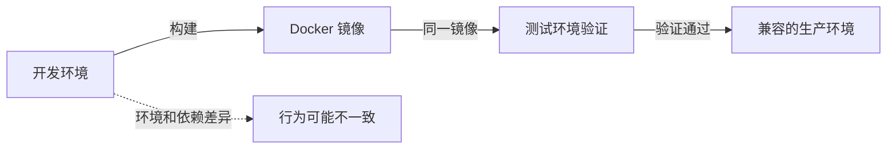
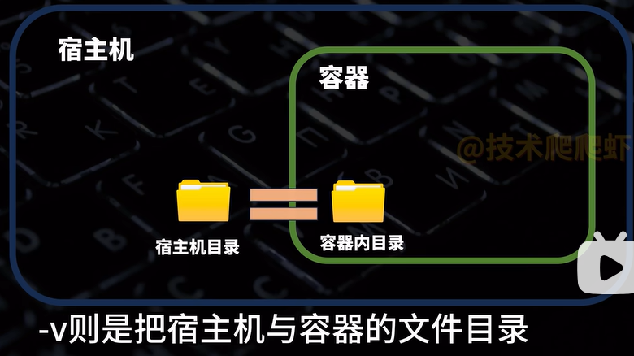
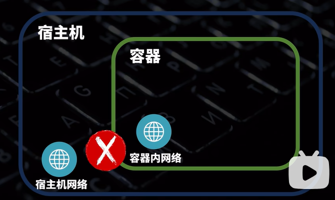
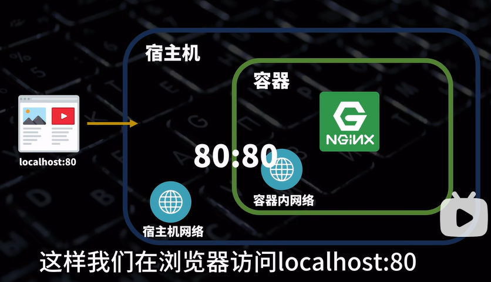
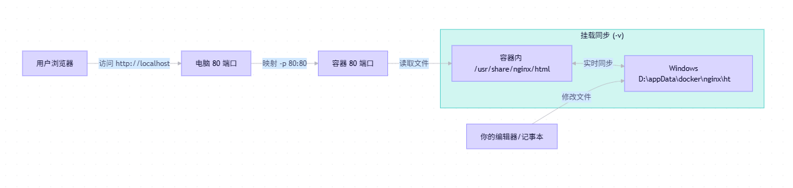

# Docker 学习笔记

## 目录

1. [Docker 入门](#1-docker-入门)
   - 什么是 Docker
   - 为什么要用 Docker
   - Docker 是什么、适合解决什么问题
   - 镜像、容器、仓库和数据卷
   - 容器与虚拟机的区别
2. [安装与快速体验](#2-安装与快速体验)
   - Windows：Docker Desktop 与 WSL 2
   - Linux、macOS 安装入口
   - 验证安装并运行第一个容器
3. [镜像管理](#3-镜像管理)
   - 拉取、查看和删除镜像
   - 镜像名称与版本标签
   - 镜像与容器的关系
4. [容器管理](#4-容器管理)
   - 创建、启动、停止和删除容器
   - 查看状态、日志和配置
   - 进入容器与执行命令
   - 常用参数：`-d`、`--name`、`-p`、`-v`、`-e`
5. [数据持久化](#5-数据持久化)
   - 容器可写层与数据丢失
   - 数据卷与绑定挂载的区别
   - 创建、查看和使用数据卷
   - Windows 与 Linux 的路径写法
   - 为已有容器迁移数据
6. [网络与外部访问](#6-网络与外部访问)
   - 端口映射与访问地址
   - 主机防火墙和云服务器安全组
   - 数据库远程访问与安全注意事项
7. [构建自己的镜像](#7-构建自己的镜像)
   - `Dockerfile` 的作用与基本指令
   - 构建并运行一个简单镜像
8. [常见应用实践](#8-常见应用实践)
   - MySQL：数据持久化、账号与连接
   - Nginx：配置文件与网页目录挂载
   - Node.js：运行应用与映射端口
9. [备份与迁移](#9-备份与迁移)
   - 镜像的保存与加载
   - 容器导出、导入及其限制
   - 数据卷与绑定目录的备份恢复
   - MySQL 备份的一致性注意事项
10. [镜像仓库](#10-镜像仓库)
    - Docker Hub 基本使用
    - 腾讯云 TCR：登录、标记、推送和拉取
11. [进阶入口与常见问题](#11-进阶入口与常见问题)
    - Docker Compose 简介
    - 镜像拉取失败、端口占用、容器退出等排查
    - 官方文档与学习资料

## 1 Docker 入门

### 什么是 Docker

Docker 是一个用于构建、分发和运行容器的开源平台。它把应用及其用户态依赖打包成标准镜像，再从镜像启动容器。镜像不包含宿主机内核；目标环境的 CPU 架构、内核能力、配置和外部依赖仍会影响运行结果。

虚拟机虚拟硬件并运行完整的客户机操作系统；Linux 容器在宿主机内核上运行隔离进程。容器通常启动更快、基础开销更少，但与虚拟机的隔离边界不同。

| 对比项 | 容器 | 传统虚拟机 |
| :--- | :--- | :--- |
| 虚拟化层 | 在宿主机操作系统上隔离进程，共享 Linux 内核 | 虚拟硬件上运行独立的客户机操作系统 |
| 启动与基础开销 | 通常较快、较少 | 需启动客户机操作系统，通常较多 |
| 运行性能 | 许多工作负载接近原生，实际表现因应用与主机而异 | 受虚拟化层和工作负载影响 |
| 隔离边界 | 共享宿主机内核 | 有独立客户机操作系统，适用于需要不同内核或更强隔离的场景 |
| 单机部署密度 | 通常可容纳更多实例，仍受资源需求限制 | 每个实例都运行客户机操作系统，资源占用较高 |


上图引自《Docker 从入门到实践》第 1.2 节；该书采用 CC BY-NC-SA 4.0 许可。

- **Linux 技术基础**：Namespaces 隔离进程、网络和挂载等资源；cgroups 计量或限制 CPU、内存、I/O；UnionFS/OverlayFS 支持镜像分层。
- **运行架构**：Docker 客户端向守护进程发出请求；常见 Linux Docker Engine 使用 containerd 管理容器生命周期，runc 按 OCI 运行时规范创建容器。具体实现会随平台和版本演进。
- **发展与生态**：Docker 起源于 dotCloud 的内部项目，2013 年 3 月开源，同年年底公司更名为 Docker, Inc.；Docker 0.9 引入 libcontainer，随后发展出 runC，并于 2015 年推动 OCI 容器标准化。Docker 主要以 Go 语言开发，相关生态还包括 Kubernetes、Podman 等。
- **版本提示**：教程以 Docker Engine v29.x 为基准，并提到 v29 全新安装默认使用 containerd image store；实际行为以所用版本的 Docker 官方文档为准。

更多内容见教程[“什么是 Docker”](https://yeasy.gitbook.io/docker_practice/di-yi-bu-fen-ru-men-pian/01_introduction/1.2_what)。

### 为什么要用 Docker

Docker 主要用于减少环境差异、提高软件交付的可重复性。常见问题包括：

- **开发环境能运行，部署后却失败**：开发、测试、生产环境的 Python、Node.js、Java 等运行时、依赖版本、操作系统设置或环境变量不一致；本机额外安装的工具也可能成为未记录的依赖。
- **配置新环境费时**：新成员需要安装运行时和依赖并逐一排查问题；配置步骤遗漏或未记录时，环境难以复现。
- **服务器迁移容易遗漏**：原服务器的配置文档缺失或无人维护，新机器可能缺少依赖和启动参数。

核心流程是**构建镜像、在测试环境验证，再将同一镜像部署到兼容的目标环境**。镜像可减少重复配置，但不能消除 CPU 架构、内核、网络、挂载数据、环境变量和外部服务的差异。



主要优势和适用场景：

1. **环境一致性**：镜像可包含应用代码、运行时、库、工具和默认配置；CPU 架构、宿主机内核、环境变量、网络、卷和外部服务仍须匹配。
2. **更快启动**：容器通常无需为每个应用启动完整客户机操作系统。教程列出的空系统、MySQL 和 Web 应用启动时间是特定环境下的演示数据，不是性能保证。
3. **资源利用**：容器共享宿主机内核，减少重复运行操作系统的开销。教程以 64 GB 服务器举例比较可用于应用的内存（约 18 GB 与约 60 GB）；此为基于特定假设的说明，不是通用估算。
4. **持续交付**：Dockerfile 描述可重复、可追踪的构建过程，可串联代码提交、构建、容器内测试和部署，配合 GitHub Actions 等工具形成 CI/CD 流程。
5. **便于迁移**：镜像可用于本地 macOS、Windows、Linux，公有云、私有数据中心和边缘设备；运行前要核对操作系统、CPU 架构、内核、网络及外部依赖。
6. **适合微服务**：服务可隔离、独立构建、部署和扩缩容，也可使用不同语言与框架。

Docker 不适合所有场景：运行不受信任代码或需要更强隔离时应评估虚拟机；依赖特殊内核、内核模块或硬件的应用可能需要其他方案；传统 Windows 原生应用和桌面图形程序也可能不适合直接容器化。

更多内容见教程[“为什么要用 Docker”](https://yeasy.gitbook.io/docker_practice/di-yi-bu-fen-ru-men-pian/01_introduction/1.3_why)。

### 镜像、容器、仓库和数据卷

- **镜像（Image）**：包含程序、依赖和默认配置的只读模板；一个镜像可以创建多个容器。
- **容器（Container）**：镜像的运行实例，通常有隔离的进程空间和独立的可写层。停止、重启的是同一个容器；重新运行镜像通常会创建新容器。
- **镜像仓库（Registry）**：存放和分发镜像的服务，例如 Docker Hub 和腾讯云 TCR。
- **数据卷（Volume）**：由 Docker 管理的持久化存储，生命周期独立于容器。

### 容器与虚拟机的区别

- Linux 容器共享运行它们的 Linux 内核，通常比需要运行独立操作系统的虚拟机更轻量。
- Windows 上的 Linux 容器通常运行在 WSL 2 或 Linux 虚拟机内。
- 容器隔离不等于绝对安全：仍需更新镜像、限制权限和网络访问，不要随意挂载敏感目录或 Docker socket。

## 2 安装与快速体验

### Windows：Docker Desktop 与 WSL 2

Windows 上运行 Linux 容器，常见有两条路线：

| 路线 | Docker 守护进程的位置 | 是否需要 Docker Desktop | 适合场景 |
| :--- | :--- | :--- | :--- |
| Docker Desktop + WSL 2 | Docker Desktop 管理的 Linux 环境 | 需要 | 希望快速开始，并需要 Windows、VS Code、图形界面和容器管理集成 |
| WSL 2 + Docker Engine | WSL 2 中的 Ubuntu | 不需要 | 希望学习 Linux、Docker 守护进程、权限、服务管理和接近服务器的运行方式 |

Docker Desktop 不是 Windows 上运行 Linux 容器的必选项。Docker Desktop 会提供更完整的 Windows 集成；WSL 2 + Docker Engine 则把 Docker 直接安装在 Ubuntu 中，Git Bash 只作为 Windows 侧的入口。两条路线不要同时作为日常 Docker 环境使用，否则容易混淆当前 CLI 连接的 Docker daemon、镜像、容器和数据卷。

#### 路线 A：Docker Desktop + WSL 2

适合希望少配置、直接使用 Compose 或 VS Code 集成的场景。按 [Docker Desktop 官方 Windows 安装说明](https://docs.docker.com/desktop/setup/install/windows-install/)检查 Windows 版本、硬件虚拟化和 WSL 2 要求，安装后选择 Linux 容器模式。Docker Desktop 使用 WSL 2 后端时，**不要求额外安装 Hyper-V**；需要 Windows 容器或 Hyper-V 后端时，才应按官方要求选择相应的安装模式。

#### 路线 B：WSL 2 + Docker Engine（命令行学习路线）

推荐学习 Docker 和 Linux 的程序员使用这条路线。WSL 2 提供 Linux 内核和 Ubuntu 环境，Docker Engine、containerd、Buildx 和 Compose Plugin 全部安装在 Ubuntu 中，不安装 Docker Desktop。

1. **安装或检查 WSL 2**。在管理员 PowerShell 或 Git Bash 中执行：

   ```bash
   wsl.exe --install -d Ubuntu --location "D:\\software\\backend\\WSL\\Ubuntu" --no-launch
   wsl.exe --set-default-version 2
   ```

   如果 Microsoft Store 或 WSL 在线安装器不可用，应先使用微软官方 Store 包安装 WSL 和 Ubuntu，再使用 `wsl --export`、`wsl --import` 将发行版迁移到目标目录。执行 `wsl --unregister` 前必须确认导出文件存在且可用，因为该命令会删除对应发行版的数据。

2. **确认发行版版本和位置**：

   ```bash
   wsl.exe --list --verbose
   ```

   输出中的 `VERSION` 应为 `2`。例如本机使用的发行版名称是 `Ubuntu-D`，其数据目录为：

   ```text
   D:\\software\\backend\\WSL\\Ubuntu
   ```

   WSL 2 会在该目录中使用 `ext4.vhdx` 保存 Ubuntu 文件系统；不要用 Windows 工具直接修改这个虚拟磁盘。需要从 Windows 访问 Linux 文件时，可使用 `\\wsl$\\Ubuntu-D` 或在 Ubuntu 中执行 `explorer.exe .`。

3. **在 Ubuntu 中安装 Docker Engine**。按 [Docker Engine Ubuntu 官方安装说明](https://docs.docker.com/engine/install/ubuntu/)配置 Docker 官方 apt 仓库，并安装：

   ```bash
   sudo apt install docker-ce docker-ce-cli containerd.io \
     docker-buildx-plugin docker-compose-plugin
   ```

   将日常用户加入 `docker` 组后，重新进入 WSL，使组权限生效：

   ```bash
   sudo usermod -aG docker "$USER"
   exit
   ```

4. **让 Docker 随 WSL 2 启动**。在 `/etc/wsl.conf` 中启用 systemd：

   ```ini
   [boot]
   systemd=true
   ```

   然后在 Windows 侧重启 WSL：

   ```bash
   wsl.exe --shutdown
   wsl.exe -d Ubuntu-D
   ```

   在 Ubuntu 中启用 Docker 服务：

   ```bash
   sudo systemctl enable --now docker
   systemctl is-enabled docker
   systemctl is-active docker
   ```

   配置成功后，不需要每次单独运行 Docker 后台命令；启动 `Ubuntu-D` 时，systemd 会启动 Docker 服务。`wsl.exe --shutdown` 会停止所有 WSL 实例及其中的 Docker 服务。

5. **从 Ubuntu 或 Git Bash 验证**：

   ```bash
   docker version
   docker compose version
   docker run --rm hello-world
   ```

   在 Git Bash 中也可以直接调用 WSL 内的 Docker：

   ```bash
   wsl.exe -d Ubuntu-D -- docker ps
   wsl.exe -d Ubuntu-D -- docker compose version
   ```

   `docker version` 能同时显示 Client 和 Server，说明 CLI 已连接 Docker daemon。`hello-world` 需要从 Docker Hub 拉取镜像；如果 Docker daemon 正常但该命令超时，应排查 Docker Hub 网络、代理和镜像源，而不是重新安装 Docker。

#### Windows 路线的选择建议

- **初学 Docker、重视 Windows 集成**：选择 Docker Desktop + WSL 2。
- **学习 Linux 和 Docker 运行机制、准备使用 Linux 服务器**：选择 WSL 2 + Docker Engine。
- **需要 Windows 容器**：选择支持 Windows 容器的 Docker Desktop 全用户安装模式；WSL 中直接安装的 Docker Engine 主要用于 Linux 容器。
- **本机当前学习方案**：使用 WSL 2 + `Ubuntu-D` + Docker Engine，Docker 数据随 WSL 发行版保存在 `D:\\software\\backend\\WSL\\Ubuntu`，不再安装 Docker Desktop。

### Linux、macOS 安装入口

- **Linux**：按发行版对应的 [Docker Engine 安装文档](https://docs.docker.com/engine/install/)安装并启动服务。Docker 守护进程权限很高，不要随意将用户加入有 Docker 管理权限的用户组。
- **macOS**：根据芯片类型，按 [Docker Desktop 安装文档](https://docs.docker.com/desktop/setup/install/mac-install/)安装并启动。

### 验证安装并运行第一个容器

在 Linux/bash 或 Windows PowerShell 中检查并运行：

```bash
docker version
docker run --rm hello-world
```

`docker run` 必须指定镜像；本例需要联网下载 `hello-world`，成功后输出欢迎信息。`--rm` 会在进程结束后自动移除这次的临时容器，不会删除镜像。

**练习约定**：选择仓库以外的独立工作目录，以下命令均从该目录执行；标有特定系统的命令只在对应终端运行。先用 `docker ps -a`、`docker volume ls` 检查名称，确认端口未被占用；若有冲突，改用新名称或端口，并同步修改后续引用。示例中的版本标签可能更新，生产环境应固定经验证的具体版本或镜像摘要。

## 3 镜像管理

### 拉取、查看和删除镜像

Linux/bash 和 Windows PowerShell：

```bash
docker pull alpine:3.22
docker image ls
docker image inspect alpine:3.22
```

- `pull` 下载镜像；`image ls` 查看本地镜像；`inspect` 查看元数据。
- 完成相关练习后，可以用 `docker image rm alpine:3.22` 删除不再需要的镜像。
- 清理前先确认镜像不再被需要；删除镜像不会代替数据卷备份。
- 完整镜像的离线迁移使用第 9 节的 `docker save` / `docker load`。

### 镜像名称与版本标签

- `alpine:3.22` 中，`alpine` 是镜像名，`3.22` 是标签；省略标签时通常使用 `latest`。
- 标签可以更新，生产环境应选择经验证的具体版本或镜像摘要；不要把 `latest` 当作不可变版本。

### 镜像与容器的关系

镜像是创建容器的只读模板，一个镜像可以创建多个互不相同的容器；容器在运行时有自己的可写层。

## 4 容器管理

### 创建、启动、停止和删除容器

Linux/bash 和 Windows PowerShell：

```bash
docker run -d --name docker-manage-demo -p 127.0.0.1:18080:80 nginx:stable-alpine
docker stop docker-manage-demo
docker start docker-manage-demo
```

完成以下查看和执行练习后，可先停止容器，再用 `docker rm docker-manage-demo` 删除它。删除前确认可写层数据已备份；不要盲目使用强制或批量清理。

### 查看状态、日志和配置

```bash
docker ps
docker ps -a
docker logs --tail 50 docker-manage-demo
docker inspect docker-manage-demo
```

### 进入容器与执行命令

```bash
docker exec -it docker-manage-demo sh
```

进入容器后输入 `exit` 退出。也可以直接执行 `docker exec docker-manage-demo nginx -v`，无需进入交互式终端。

### 常用参数：`-d`、`--name`、`-p`、`-v`、`-e`

- `-d`：在后台运行容器。
- `--name`：指定容器名称。
- `-p`：发布端口，例如 `127.0.0.1:18080:80` 表示将本机 18080 映射到容器 80 端口。
- `-v`：挂载数据卷或主机路径；也可以使用更明确的 `--mount`。
- `-e`：设置环境变量；真实密码不应直接写入命令历史。

`docker run` 的选项后必须指定镜像，镜像后可再指定启动命令。

## 5 数据持久化

### 容器可写层与数据丢失

容器可写层中的数据在容器删除后会消失。需要保留的数据应使用持久化存储，并另行备份；持久化不等于备份。

### 数据卷与绑定挂载的区别

| 类型 | 管理方式 | 适用场景 |
| :--- | :--- | :--- |
| 命名卷（Volume） | Docker 管理，生命周期独立于容器 | 数据库及其他长期数据 |
| 绑定挂载（bind mount） | 用户指定 Docker 主机上的文件或目录 | 配置文件、网页和需要直接访问的文件 |

- 两者都可能遮住镜像中目标路径的原有内容；新空卷首次挂载到非空目录时，默认可复制镜像中该目录的内容，绑定挂载不会自动复制。
- 多个容器可共享数据，但应用必须处理并发写入。容器删除后，命名卷和主机绑定目录通常仍在；主动删除卷、文件或执行清理仍可能丢失数据。
- 权限、所有者和性能取决于实际文件系统。不要挂载敏感目录；能只读就用 `readonly`。
- Linux 本地卷通常存放于 Docker 的数据目录。Docker Desktop 的卷实际位于 Linux VM/WSL 环境中；优先用 `docker volume inspect` 查看，不要假设路径能在 Windows 直接访问。



### 创建、查看和使用数据卷

Linux/bash 和 Windows PowerShell：先执行 `docker volume ls`。下例要求 `docker-demo-files` 尚不存在；否则换一个新名称并同步修改第 9 节。`volume create` 遇到已有同名卷会复用，而不是清空它。

```bash
docker volume create docker-demo-files
docker volume inspect docker-demo-files
docker run --rm --mount type=volume,src=docker-demo-files,dst=/data alpine:3.22 touch /data/example.txt
```

临时容器退出后自动移除，卷仍保留；第 9 节使用该卷演示普通文件备份。

`-v` 是另一种挂载写法，例如 `-v docker-demo-files:/data:ro` 将该卷只读挂载到 `/data`。左侧是卷名时使用数据卷，是主机路径时使用绑定挂载；`--mount` 的类型更明确。

### Windows 与 Linux 的路径写法

- Linux/bash：可用 `$(pwd)/data` 表示当前目录下的 `data`，例如 `--mount "type=bind,src=$(pwd)/data,dst=/data"`。
- Windows PowerShell：可先用 `$dataPath = (Resolve-Path .\data).Path` 获取绝对路径，再使用 `--mount "type=bind,src=$dataPath,dst=/data"`。
- 以上是挂载参数，不是独立命令；使用前先创建主机目录。路径包含空格时应保留引号，示例路径避免包含逗号。

### 为已有容器迁移数据

容器创建后不能直接添加挂载。以下仅适用于**普通文件**：先检查旧容器配置，停止所有写入，再复制数据并用新名称创建容器。保留旧容器直到核对完成；数据库应按第 9 节使用一致性备份。

下列 `old-app`、`/app/data`、`app-migrated` 和 `IMAGE:TAG` 是占位符，必须替换；还须根据 `docker inspect` 补齐原有环境变量、网络、启动参数和不冲突的端口，否则新容器不一定能运行。复制前确认 `migrated-data` 不存在，选择没有逗号的工作路径。

Linux/bash：

```bash
docker inspect old-app
docker stop old-app
mkdir ./migrated-data
docker cp old-app:/app/data/. ./migrated-data/
docker run -d --name app-migrated --mount "type=bind,src=$(pwd)/migrated-data,dst=/app/data" IMAGE:TAG
```

Windows PowerShell：

```powershell
docker inspect old-app
docker stop old-app
New-Item -ItemType Directory -Path .\migrated-data
docker cp old-app:/app/data/. .\migrated-data\
$dataPath = (Resolve-Path .\migrated-data).Path
docker run -d --name app-migrated --mount "type=bind,src=$dataPath,dst=/app/data" IMAGE:TAG
```

检查复制后的内容、权限和 UID/GID，再验证新容器。若改用命名卷，先确认 `app-migrated-data` 不存在，创建新卷，再将刚复制的普通文件写入卷：

```bash
docker volume create app-migrated-data
```

Linux/bash：

```bash
docker run --rm --mount "type=bind,src=$(pwd)/migrated-data,dst=/source,readonly" --mount type=volume,src=app-migrated-data,dst=/data alpine:3.22 cp -a /source/. /data/
```

Windows PowerShell，继续使用上面定义的 `$dataPath`：

```powershell
docker run --rm --mount "type=bind,src=$dataPath,dst=/source,readonly" --mount type=volume,src=app-migrated-data,dst=/data alpine:3.22 cp -a /source/. /data/
```

随后创建新容器时，用 `--mount type=volume,src=app-migrated-data,dst=/app/data` 替换绑定挂载。检查卷内文件和权限，不要让多个实例同时写入同一份数据，也不要将两个挂载指向同一目标路径。

## 6 网络与外部访问

### 端口映射与访问地址

- `-p 127.0.0.1:18080:80` 将本机 18080 端口映射到容器 80 端口；省略主机地址可能向外网暴露。
- 容器内的 `localhost` 指容器自身；同一用户自定义网络中的容器可通过名称通信。对外发布时，应用还需监听容器内可访问的地址。




### 主机防火墙和云服务器安全组

- 对外提供服务时，需要检查宿主机防火墙及云服务器安全组，只允许必要的端口和来源。
- 本文示例默认绑定回环地址。旧版 Docker 可能存在同网段访问回环发布端口的问题；应更新并结合防火墙、云安全组及实际网络验证，不把绑定地址当作唯一安全屏障。

### 数据库远程访问与安全注意事项

- 仅在确有需要时允许外部连接：优先 VPN 或隧道，限制来源 IP、端口和应用账号权限，并验证未授权来源无法访问。

例如，第 8 节的 MySQL 部署在远程服务器时，可从本机通过 SSH 隧道访问，而不必直接公开数据库端口：

1. 在本机 Linux/bash 或已安装 OpenSSH 的 Windows PowerShell 中执行，先将 `user@SERVER` 替换为服务器的登录账号和地址：

   ```bash
   ssh -L 13307:127.0.0.1:3307 user@SERVER
   ```

2. 保持 SSH 连接，在本机 MySQL 客户端连接 `127.0.0.1:13307`，使用第 8 节创建的业务账号。

如果必须直接开放远程端口，需要重新创建使用适当主机地址映射的容器，并检查 MySQL 监听地址、账号来源和权限、主机防火墙及云安全组；应启用 TLS，限制来源 IP，不开放 root 账号。

## 7 构建自己的镜像

### Dockerfile 的作用与基本指令

`Dockerfile` 用来描述镜像的构建步骤，常用指令包括：

- `FROM`：选择基础镜像。
- `COPY`：将构建上下文中的文件复制到镜像。
- `RUN`：在构建镜像时执行命令。
- `CMD`：设置容器启动时的默认命令。

### 构建并运行一个简单镜像

在练习工作目录下创建全新的 `docker-build-demo` 目录，并用编辑器创建以下两个文件。

`docker-build-demo/index.html`：

```html
<!doctype html>
<html lang="zh-CN"><meta charset="utf-8"><title>Docker</title><body>Hello Docker</body></html>
```

`docker-build-demo/Dockerfile`：

```dockerfile
FROM nginx:stable-alpine
COPY index.html /usr/share/nginx/html/index.html
```

Linux/bash 和 Windows PowerShell，在练习工作目录执行：

```bash
docker build -t local/dockerfile-demo:1.0 ./docker-build-demo
docker run -d --name dockerfile-demo-web -p 127.0.0.1:18070:80 local/dockerfile-demo:1.0
```

浏览器访问 `http://127.0.0.1:18070/`。构建上下文是指定目录；不要将密码等敏感文件放入上下文或镜像。`stable-alpine` 是可能更新的标签，不是不可变版本。

## 8 常见应用实践

以下练习使用独立名称；先检查端口、目录和容器名是否可用。生产环境应使用安全的凭据管理方式，并根据应用要求配置权限和网络。

### MySQL：数据持久化、账号与连接

1. 在练习目录创建 `mysql.env`，将下面的占位值替换为各不相同的强密码：

   ```dotenv
   MYSQL_ROOT_PASSWORD=REPLACE_WITH_A_STRONG_ROOT_PASSWORD
   MYSQL_DATABASE=appdb
   MYSQL_USER=app
   MYSQL_PASSWORD=REPLACE_WITH_A_DIFFERENT_STRONG_PASSWORD
   ```

2. 在 Linux/bash 或 Windows PowerShell 中启动并查看日志：

   ```bash
   docker volume create docker-mysql-data
   docker run -d --name docker-mysql-demo -p 127.0.0.1:3307:3306 --mount type=volume,source=docker-mysql-data,target=/var/lib/mysql --env-file ./mysql.env mysql:8.4
   docker logs --tail 50 docker-mysql-demo
   ```

3. 等待初始化完成后，使用业务账号连接，按提示输入密码：

   ```bash
   docker exec -it docker-mysql-demo mysql -u app -p appdb
   ```

- 退出 MySQL 输入 `exit`；宿主机客户端可连接 `127.0.0.1:3307`。
- 环境变量只在空数据目录首次初始化时生效；已有卷不会因修改密码变量而重置账号。
- `MYSQL_USER` 和 `MYSQL_PASSWORD` 创建业务用户并授予其指定业务库的权限；生产环境应进一步按需细分权限。
- `mysql` 是 MySQL 的系统数据库，`appdb` 才是此例的业务数据库。
- 限制 `mysql.env` 的文件权限，不要提交到仓库。环境变量仍可能被有权限的用户查看；生产环境应使用适当的密钥管理方式。
- 如需远程连接，优先使用 VPN 或隧道，限制来源 IP 和账号权限，并按需要配置 TLS；不要向公网开放 root 账号。

如需将 MySQL 数据放在指定主机目录，可以先创建空目录 `docker-mysql-bind`，然后用以下对应参数**替换**上面 `docker run` 命令中的卷挂载参数；这些参数片段不能单独执行：

- Linux/bash：`--mount "type=bind,source=$(pwd)/docker-mysql-bind,target=/var/lib/mysql"`
- Windows PowerShell：先执行 `$mysqlPath = (Resolve-Path .\docker-mysql-bind).Path`，再使用 `--mount "type=bind,source=$mysqlPath,target=/var/lib/mysql"`。

确保容器内的 MySQL 用户有目录读写权限；不要同时把两个挂载指向 `/var/lib/mysql`。切换到新目录不会自动迁移原卷数据，迁移数据库应使用第 9 节的一致性备份。

### Nginx：配置文件与网页目录挂载

下面两种方式任选一种；都使用新建的 `docker-nginx-site` 目录存放网页。

Linux/bash：

```bash
mkdir ./docker-nginx-site
printf '%s\n' '<h1>Hello Docker</h1>' > ./docker-nginx-site/index.html
docker run -d --name docker-nginx-demo -p 127.0.0.1:8080:80 --mount "type=bind,src=$(pwd)/docker-nginx-site,dst=/usr/share/nginx/html,readonly" nginx:stable-alpine
```

Windows PowerShell：

```powershell
New-Item -ItemType Directory -Path .\docker-nginx-site
Set-Content -Path .\docker-nginx-site\index.html -Value '<h1>Hello Docker</h1>' -Encoding utf8
$webPath = (Resolve-Path .\docker-nginx-site).Path
docker run -d --name docker-nginx-demo -p 127.0.0.1:8080:80 --mount "type=bind,src=$webPath,dst=/usr/share/nginx/html,readonly" nginx:stable-alpine
```

访问 `http://127.0.0.1:8080/`；修改主机网页文件后刷新即可查看。需要自定义配置时，可先用 `docker cp docker-nginx-demo:/etc/nginx/nginx.conf ./nginx.conf` 复制配置，再检查并挂载；复制前确认目标文件不存在，避免覆盖。不要用空目录遮住必需的配置。



### Node.js：运行应用与映射端口

1. 新建 `docker-node-demo` 目录，在其中创建 `server.js`：

   ```javascript
   const http = require('node:http');

   http.createServer((req, res) => {
     res.end('Hello Docker');
   }).listen(3000, '0.0.0.0');
   ```

2. 在练习目录执行对应命令：

   Linux/bash：

   ```bash
   docker run -d --name docker-node-demo -p 127.0.0.1:3600:3000 --mount "type=bind,src=$(pwd)/docker-node-demo,dst=/app,readonly" -w /app node:22-alpine node server.js
   ```

   Windows PowerShell：

   ```powershell
   $nodePath = (Resolve-Path .\docker-node-demo).Path
   docker run -d --name docker-node-demo -p 127.0.0.1:3600:3000 --mount "type=bind,src=$nodePath,dst=/app,readonly" -w /app node:22-alpine node server.js
   ```

访问 `http://127.0.0.1:3600/`。`0.0.0.0` 让服务监听容器内的网络接口；宿主机端口仍只绑定本机。实际部署时可使用 Dockerfile 打包应用及其依赖。

## 9 备份与迁移

### 镜像的保存与加载

完整镜像迁移使用 `save` 和 `load`：

```bash
docker save -o dockerfile-demo.tar local/dockerfile-demo:1.0
docker load -i dockerfile-demo.tar
```

将 tar 文件安全复制到目标主机后再执行 `load`。镜像不包含容器的可写层或挂载数据；重新创建容器时还要恢复端口、环境变量、网络和挂载配置。

### 容器导出、导入及其限制

`docker export` 导出容器文件系统快照，`docker import` 将其导入为新镜像；它们不保留原镜像层和完整镜像配置，也不备份挂载卷。通常优先保留 Dockerfile、原镜像及独立的数据备份。

例如，导出第 8 节的 Nginx 容器并导入为新镜像：

```bash
docker export -o nginx-filesystem.tar docker-nginx-demo
docker import nginx-filesystem.tar local/imported-nginx:1.0
```

导入后的镜像不一定具备原镜像的启动命令；挂载目录的数据需要另外备份。

### 数据卷与绑定目录的备份恢复

**数据卷备份与恢复：**

Docker 没有 `docker volume export` 或 `docker volume import` 命令。以下示例备份第 5 节创建的普通文件卷；先停止所有写入该卷的应用，在工作目录准备 `backup` 目录，并检查目标备份文件不存在，以免覆盖。

Linux/bash：

```bash
mkdir -p backup
docker run --rm --mount type=volume,source=docker-demo-files,target=/data,readonly --mount "type=bind,source=$(pwd)/backup,target=/backup" alpine:3.22 tar czf /backup/docker-demo-files.tar.gz -C /data .
```

Windows PowerShell：

```powershell
New-Item -ItemType Directory -Force -Path .\backup
$backupPath = (Resolve-Path .\backup).Path
docker run --rm --mount type=volume,source=docker-demo-files,target=/data,readonly --mount "type=bind,source=$backupPath,target=/backup" alpine:3.22 tar czf /backup/docker-demo-files.tar.gz -C /data .
```

将备份安全地复制到目标主机的 `backup` 目录，确认 `docker-demo-files-restored` 不存在，创建全新空卷并恢复。Linux/bash：

```bash
docker volume create docker-demo-files-restored
docker run --rm --mount type=volume,source=docker-demo-files-restored,target=/data --mount "type=bind,source=$(pwd)/backup,target=/backup,readonly" alpine:3.22 tar xzf /backup/docker-demo-files.tar.gz -C /data
docker run --rm --mount type=volume,source=docker-demo-files-restored,target=/data,readonly alpine:3.22 ls -la /data
```

Windows PowerShell：

```powershell
$backupPath = (Resolve-Path .\backup).Path
docker volume create docker-demo-files-restored
docker run --rm --mount type=volume,source=docker-demo-files-restored,target=/data --mount "type=bind,source=$backupPath,target=/backup,readonly" alpine:3.22 tar xzf /backup/docker-demo-files.tar.gz -C /data
docker run --rm --mount type=volume,source=docker-demo-files-restored,target=/data,readonly alpine:3.22 ls -la /data
```

- 不要将不可信的归档解压到卷中；恢复后应检查文件、权限和应用是否正常。绑定挂载需要单独备份宿主机文件。
- 数据库优先使用数据库自身的一致性备份工具；文件级备份必须先安全停止数据库或采用受支持的一致性快照方案，并验证恢复。
- 数据库备份可能包含敏感信息，需限制访问并妥善保存；文件级恢复还需考虑数据库版本及文件所有权。

**绑定目录备份与恢复：**停止写入后，可以使用宿主机工具复制文件。以下示例使用第 8 节的网页目录；先确认 `backup` 目录存在，且 `backup/nginx-site` 和 `nginx-site-restored` 不存在。

Linux/bash：

```bash
cp -a ./docker-nginx-site ./backup/nginx-site
cp -a ./backup/nginx-site ./nginx-site-restored
```

Windows PowerShell：

```powershell
Copy-Item -Path .\docker-nginx-site -Destination .\backup\nginx-site -Recurse
Copy-Item -Path .\backup\nginx-site -Destination .\nginx-site-restored -Recurse
```

恢复到目标主机后，在重新创建容器时把挂载源指向恢复后的目录，并检查文件内容和权限；跨系统复制时尤其要核对所有权和特殊文件。

### MySQL 备份的一致性注意事项

下面备份第 8 节的 `appdb`。先确认容器内 `/tmp/appdb-backup.sql` 和宿主机 `./appdb-backup.sql` 不存在，避免覆盖已有文件：

1. 在 Linux/bash 或 Windows PowerShell 中进入容器：

   ```bash
   docker exec -it docker-mysql-demo sh
   ```

2. 在容器内运行备份，按提示输入 root 密码；完成后输入 `exit` 退出容器：

   ```sh
   mysqldump -u root -p --single-transaction --databases appdb > /tmp/appdb-backup.sql
   exit
   ```

3. 在宿主机复制备份文件，并妥善保护：

   ```bash
   docker cp docker-mysql-demo:/tmp/appdb-backup.sql ./appdb-backup.sql
   ```

`--single-transaction` 主要保证 InnoDB 等事务表的一致性；备份期间避免结构变更，非事务表需要额外处理。确认备份可用后，应安全清理容器中的临时副本。

恢复时，先准备独立的空 MySQL 实例，确认版本兼容且目标数据可被写入；以下 `restore-mysql` 代表该目标容器，使用前必须替换为实际名称：

```bash
docker cp ./appdb-backup.sql restore-mysql:/tmp/appdb-backup.sql
docker exec -it restore-mysql sh
```

在目标容器内按提示输入 root 密码后恢复，再输入 `exit`：

```sh
mysql -u root -p < /tmp/appdb-backup.sql
exit
```

备份包含建库语句，恢复可能修改目标实例中的同名数据库；不要直接对生产实例执行，应先在隔离环境验证。

## 10 镜像仓库

### Docker Hub 基本使用

Docker Hub 可以用于查找、拉取和分发镜像。例如，拉取镜像使用 `docker pull alpine:3.22`。需要推送时，先准备有权限的仓库，将下面的 `your-docker-id` 替换为自己的 Docker Hub 用户名：

```bash
docker login
docker tag local/dockerfile-demo:1.0 your-docker-id/dockerfile-demo:1.0
docker push your-docker-id/dockerfile-demo:1.0
```

登录时按提示操作，不要把密码写进命令历史；推送会将镜像上传到对应仓库。

### 腾讯云 TCR：登录、标记、推送和拉取

腾讯云容器镜像服务（TCR）也可存储、分发镜像：

1. 在控制台创建或选择实例、命名空间和镜像仓库，获取实际仓库地址及登录方式。
2. 将下列尖括号及其中内容替换为控制台提供的信息；这些是命令格式，**不能原样执行**。
3. 在 Linux/bash 或 Windows PowerShell 中登录、标记、推送或拉取：

   ```bash
   docker login <仓库域名>
   docker tag local/dockerfile-demo:1.0 <仓库域名>/<命名空间>/<镜像名>:1.0
   docker push <仓库域名>/<命名空间>/<镜像名>:1.0
   docker pull <仓库域名>/<命名空间>/<镜像名>:1.0
   ```

- 登录时按提示输入凭据，不要把密码写进文档或命令历史；不同实例的域名和权限以控制台为准。
- 推送的是镜像，不包含容器运行时的挂载数据；数据应按第 9 节单独备份。

## 11 进阶入口与常见问题

### Docker Compose 简介

Compose 用一个文件声明容器的镜像、端口和挂载等配置，适合管理一组相关服务。以下是单服务入门示例：

1. 新建独立目录，在其中创建 `compose.yaml`：

   ```yaml
   services:
     web:
       image: nginx:stable-alpine
       ports:
         - "127.0.0.1:18082:80"
   ```

2. 在该目录运行：

   ```bash
   docker compose up -d
   docker compose ps
   ```

3. 访问 `http://127.0.0.1:18082/`；练习结束后，可在同一目录执行 `docker compose down` 停止并移除本例服务容器和网络。

不要随意追加 `-v` 或清理卷：删除数据卷可能造成数据丢失。

### 镜像拉取失败、端口占用、容器退出等排查

- **无法连接 Docker**：确认 Docker Desktop 或 Docker Engine 已启动，并检查当前用户权限。
- **镜像拉取失败**：检查网络、代理、仓库地址和镜像标签；只使用可信的镜像源。
- **端口被占用**：更换主机端口，例如将 `8080:80` 改为 `8081:80`，并同步修改访问地址。
- **容器启动后退出**：先执行 `docker ps -a` 和 `docker logs <容器名>`，检查主进程、配置及挂载路径。
- **挂载后文件不见了**：检查主机路径是否存在，以及挂载是否遮住了容器内的原有目录。

### 官方文档与学习资料

- [Docker 从入门到实践：安装 Docker](https://yeasy.gitbook.io/docker_practice/di-yi-bu-fen-ru-men-pian/03_install)
- [Docker Desktop for Windows 安装说明](https://docs.docker.com/desktop/setup/install/windows-install/)
- [Docker Desktop for macOS 安装说明](https://docs.docker.com/desktop/setup/install/mac-install/)
- [Docker Engine 安装说明](https://docs.docker.com/engine/install/)
- [Docker 数据卷](https://docs.docker.com/engine/storage/volumes/)
- [MySQL 官方镜像](https://hub.docker.com/_/mysql)
- [Docker Compose 官方文档](https://docs.docker.com/compose/)

